<!--
  The pictures on this page are drawn by kaitosugimura.com's own code: the
  site's seeded cube world, projected by its camera and painted by its
  renderer, written out as animated SVG with nothing around it, so it sits
  on the page like the text does. The generator lives with the site, in
  scripts/readme.
-->

# Kaito Sugimura

<picture>
  <source media="(prefers-color-scheme: dark)" srcset="assets/kaito-dark.svg">
  <source media="(prefers-color-scheme: light)" srcset="assets/kaito-light.svg">
  
</picture>

**Hey!** I'm a software engineer based in Calgary, building for the web full-time. And on the side, a self-taught game developer!

In fact, [my website](https://kaitosugimura.com/) was made by me. From scratch! The tower behind me comes from it, and so does everything else drawn on this page.

[kaitosugimura.com](https://kaitosugimura.com/) · [YouTube](https://www.youtube.com/@sugimurakaito) · [LinkedIn](https://www.linkedin.com/in/kaitosugimura/)

### <picture><source media="(prefers-color-scheme: dark)" srcset="assets/glyphs-now-dark.svg"><source media="(prefers-color-scheme: light)" srcset="assets/glyphs-now-light.svg"></picture> Now building

I'm currently working on [EndPortal](https://endportal.app/).

<br clear="right">

## <picture><source media="(prefers-color-scheme: dark)" srcset="assets/glyphs-projects-dark.svg"><source media="(prefers-color-scheme: light)" srcset="assets/glyphs-projects-light.svg"></picture> Projects

| Project | What it is | Built with | Year |
| :-- | :-- | :-- | --: |
| <picture><source media="(prefers-color-scheme: dark)" srcset="assets/glyphs-gestalt-echo-dark.svg"><source media="(prefers-color-scheme: light)" srcset="assets/glyphs-gestalt-echo-light.svg"></picture> **[Gestalt Echo](https://dev-gestalt-echo.vercel.app/)** | Turn-based gacha RPG on Discord & web | React | 2026 |
| <picture><source media="(prefers-color-scheme: dark)" srcset="assets/glyphs-riruko-dark.svg"><source media="(prefers-color-scheme: light)" srcset="assets/glyphs-riruko-light.svg"></picture> **[Riruko](https://cardex-jet.vercel.app/)** | Grand Archive TCG storefront & binder | React | 2026 |
| <picture><source media="(prefers-color-scheme: dark)" srcset="assets/glyphs-pureweb-console-dark.svg"><source media="(prefers-color-scheme: light)" srcset="assets/glyphs-pureweb-console-light.svg"></picture> **PureWeb Console** | Customer-facing console redesign, as an intern | React | 2024 |
| <picture><source media="(prefers-color-scheme: dark)" srcset="assets/glyphs-im-slime-dark.svg"><source media="(prefers-color-scheme: light)" srcset="assets/glyphs-im-slime-light.svg"></picture> **[I'm Slime](https://www.youtube.com/watch?v=F0mAtFBdw5w)** | Online web multiplayer game | React | 2023 |
| <picture><source media="(prefers-color-scheme: dark)" srcset="assets/glyphs-zekka-dark.svg"><source media="(prefers-color-scheme: light)" srcset="assets/glyphs-zekka-light.svg"></picture> **[Zekka](https://www.youtube.com/watch?v=J1YpuKkc3ng)** | RPG coin dozer with events | Unreal Engine | 2022 |
| <picture><source media="(prefers-color-scheme: dark)" srcset="assets/glyphs-my-portfolio-v2-dark.svg"><source media="(prefers-color-scheme: light)" srcset="assets/glyphs-my-portfolio-v2-light.svg"></picture> **[My Portfolio V2](https://kaitosugimura.github.io/)** | My second portfolio website | JavaScript | 2022 |
| <picture><source media="(prefers-color-scheme: dark)" srcset="assets/glyphs-immortal-dark.svg"><source media="(prefers-color-scheme: light)" srcset="assets/glyphs-immortal-light.svg"></picture> **[Immortal](https://www.youtube.com/watch?v=ra7FCriWLSk)** | Hack n' slash & shooter duality game | Unreal Engine | 2022 |

And the rest, back to my very first game, on [kaitosugimura.com](https://kaitosugimura.com/#projects).

## <picture><source media="(prefers-color-scheme: dark)" srcset="assets/glyphs-motion-dark.svg"><source media="(prefers-color-scheme: light)" srcset="assets/glyphs-motion-light.svg"></picture> Motion

<picture>
  <source media="(prefers-color-scheme: dark)" srcset="assets/points-dark.svg">
  <source media="(prefers-color-scheme: light)" srcset="assets/points-light.svg">
  
</picture>

Nine short scenes, on [kaitosugimura.com](https://kaitosugimura.com/#motion):

- **Bad Apple!!** · Kirigami, Aurora, Art Deco and Swiss Poster
- **Kinetic Type** · Dizzy, Execution and Points
- **Finofo** · The AP Machine, and Expense Management Without the Receipt Chase

*Points* is the one beside this: a loose set of points gains a dimension at a time, line to square to cube.

<br clear="right">

<details>
<summary><picture><source media="(prefers-color-scheme: dark)" srcset="assets/glyphs-tower-dark.svg"><source media="(prefers-color-scheme: light)" srcset="assets/glyphs-tower-light.svg"></picture> <b>Inspect the tower in 3D</b></summary>

<!-- tower:start -->

```stl
solid tower
facet normal 1 0 0
outer loop
vertex 1 1.5 2.5
vertex 1 1.5 4.5
vertex 1 -0.5 4.5
endloop
endfacet
facet normal 1 0 0
outer loop
vertex 1 1.5 2.5
vertex 1 -0.5 4.5
vertex 1 -0.5 2.5
endloop
endfacet
facet normal -1 0 0
outer loop
vertex -1 1.5 2.5
vertex -1 -0.5 2.5
vertex -1 -0.5 4.5
endloop
endfacet
facet normal -1 0 0
outer loop
vertex -1 1.5 2.5
vertex -1 -0.5 4.5
vertex -1 1.5 4.5
endloop
endfacet
facet normal 0 0 1
outer loop
vertex -1 1.5 4.5
vertex -1 -0.5 4.5
vertex 1 -0.5 4.5
endloop
endfacet
facet normal 0 0 1
outer loop
vertex -1 1.5 4.5
vertex 1 -0.5 4.5
vertex 1 1.5 4.5
endloop
endfacet
facet normal 0 0 -1
outer loop
vertex -1 1.5 2.5
vertex 1 1.5 2.5
vertex 1 -0.5 2.5
endloop
endfacet
facet normal 0 0 -1
outer loop
vertex -1 1.5 2.5
vertex 1 -0.5 2.5
vertex -1 -0.5 2.5
endloop
endfacet
facet normal 0 -1 0
outer loop
vertex -1 -0.5 2.5
vertex 1 -0.5 2.5
vertex 1 -0.5 4.5
endloop
endfacet
facet normal 0 -1 0
outer loop
vertex -1 -0.5 2.5
vertex 1 -0.5 4.5
vertex -1 -0.5 4.5
endloop
endfacet
facet normal 0 1 0
outer loop
vertex -1 1.5 2.5
vertex -1 1.5 4.5
vertex 1 1.5 4.5
endloop
endfacet
facet normal 0 1 0
outer loop
vertex -1 1.5 2.5
vertex 1 1.5 4.5
vertex 1 1.5 2.5
endloop
endfacet
facet normal 1 0 0
outer loop
vertex 2 0 4.5
vertex 2 0 6
vertex 2 -1.5 6
endloop
endfacet
facet normal 1 0 0
outer loop
vertex 2 0 4.5
vertex 2 -1.5 6
vertex 2 -1.5 4.5
endloop
endfacet
facet normal -1 0 0
outer loop
vertex 0.5 0 4.5
vertex 0.5 -1.5 4.5
vertex 0.5 -1.5 6
endloop
endfacet
facet normal -1 0 0
outer loop
vertex 0.5 0 4.5
vertex 0.5 -1.5 6
vertex 0.5 0 6
endloop
endfacet
facet normal 0 0 1
outer loop
vertex 0.5 0 6
vertex 0.5 -1.5 6
vertex 2 -1.5 6
endloop
endfacet
facet normal 0 0 1
outer loop
vertex 0.5 0 6
vertex 2 -1.5 6
vertex 2 0 6
endloop
endfacet
facet normal 0 0 -1
outer loop
vertex 0.5 0 4.5
vertex 2 0 4.5
vertex 2 -1.5 4.5
endloop
endfacet
facet normal 0 0 -1
outer loop
vertex 0.5 0 4.5
vertex 2 -1.5 4.5
vertex 0.5 -1.5 4.5
endloop
endfacet
facet normal 0 -1 0
outer loop
vertex 0.5 -1.5 4.5
vertex 2 -1.5 4.5
vertex 2 -1.5 6
endloop
endfacet
facet normal 0 -1 0
outer loop
vertex 0.5 -1.5 4.5
vertex 2 -1.5 6
vertex 0.5 -1.5 6
endloop
endfacet
facet normal 0 1 0
outer loop
vertex 0.5 0 4.5
vertex 0.5 0 6
vertex 2 0 6
endloop
endfacet
facet normal 0 1 0
outer loop
vertex 0.5 0 4.5
vertex 2 0 6
vertex 2 0 4.5
endloop
endfacet
facet normal 1 0 0
outer loop
vertex -0.5 0 5
vertex -0.5 0 6.5
vertex -0.5 -1.5 6.5
endloop
endfacet
facet normal 1 0 0
outer loop
vertex -0.5 0 5
vertex -0.5 -1.5 6.5
vertex -0.5 -1.5 5
endloop
endfacet
facet normal -1 0 0
outer loop
vertex -2 0 5
vertex -2 -1.5 5
vertex -2 -1.5 6.5
endloop
endfacet
facet normal -1 0 0
outer loop
vertex -2 0 5
vertex -2 -1.5 6.5
vertex -2 0 6.5
endloop
endfacet
facet normal 0 0 1
outer loop
vertex -2 0 6.5
vertex -2 -1.5 6.5
vertex -0.5 -1.5 6.5
endloop
endfacet
facet normal 0 0 1
outer loop
vertex -2 0 6.5
vertex -0.5 -1.5 6.5
vertex -0.5 0 6.5
endloop
endfacet
facet normal 0 0 -1
outer loop
vertex -2 0 5
vertex -0.5 0 5
vertex -0.5 -1.5 5
endloop
endfacet
facet normal 0 0 -1
outer loop
vertex -2 0 5
vertex -0.5 -1.5 5
vertex -2 -1.5 5
endloop
endfacet
facet normal 0 -1 0
outer loop
vertex -2 -1.5 5
vertex -0.5 -1.5 5
vertex -0.5 -1.5 6.5
endloop
endfacet
facet normal 0 -1 0
outer loop
vertex -2 -1.5 5
vertex -0.5 -1.5 6.5
vertex -2 -1.5 6.5
endloop
endfacet
facet normal 0 1 0
outer loop
vertex -2 0 5
vertex -2 0 6.5
vertex -0.5 0 6.5
endloop
endfacet
facet normal 0 1 0
outer loop
vertex -2 0 5
vertex -0.5 0 6.5
vertex -0.5 0 5
endloop
endfacet
facet normal 1 0 0
outer loop
vertex 0.5 2 7.5
vertex 0.5 2 9.5
vertex 0.5 0 9.5
endloop
endfacet
facet normal 1 0 0
outer loop
vertex 0.5 2 7.5
vertex 0.5 0 9.5
vertex 0.5 0 7.5
endloop
endfacet
facet normal -1 0 0
outer loop
vertex -1.5 2 7.5
vertex -1.5 0 7.5
vertex -1.5 0 9.5
endloop
endfacet
facet normal -1 0 0
outer loop
vertex -1.5 2 7.5
vertex -1.5 0 9.5
vertex -1.5 2 9.5
endloop
endfacet
facet normal 0 0 1
outer loop
vertex -1.5 2 9.5
vertex -1.5 0 9.5
vertex 0.5 0 9.5
endloop
endfacet
facet normal 0 0 1
outer loop
vertex -1.5 2 9.5
vertex 0.5 0 9.5
vertex 0.5 2 9.5
endloop
endfacet
facet normal 0 0 -1
outer loop
vertex -1.5 2 7.5
vertex 0.5 2 7.5
vertex 0.5 0 7.5
endloop
endfacet
facet normal 0 0 -1
outer loop
vertex -1.5 2 7.5
vertex 0.5 0 7.5
vertex -1.5 0 7.5
endloop
endfacet
facet normal 0 -1 0
outer loop
vertex -1.5 0 7.5
vertex 0.5 0 7.5
vertex 0.5 0 9.5
endloop
endfacet
facet normal 0 -1 0
outer loop
vertex -1.5 0 7.5
vertex 0.5 0 9.5
vertex -1.5 0 9.5
endloop
endfacet
facet normal 0 1 0
outer loop
vertex -1.5 2 7.5
vertex -1.5 2 9.5
vertex 0.5 2 9.5
endloop
endfacet
facet normal 0 1 0
outer loop
vertex -1.5 2 7.5
vertex 0.5 2 9.5
vertex 0.5 2 7.5
endloop
endfacet
facet normal 1 0 0
outer loop
vertex 1.5 -1 8
vertex 1.5 -1 9.5
vertex 1.5 -2.5 9.5
endloop
endfacet
facet normal 1 0 0
outer loop
vertex 1.5 -1 8
vertex 1.5 -2.5 9.5
vertex 1.5 -2.5 8
endloop
endfacet
facet normal -1 0 0
outer loop
vertex 0 -1 8
vertex 0 -2.5 8
vertex 0 -2.5 9.5
endloop
endfacet
facet normal -1 0 0
outer loop
vertex 0 -1 8
vertex 0 -2.5 9.5
vertex 0 -1 9.5
endloop
endfacet
facet normal 0 0 1
outer loop
vertex 0 -1 9.5
vertex 0 -2.5 9.5
vertex 1.5 -2.5 9.5
endloop
endfacet
facet normal 0 0 1
outer loop
vertex 0 -1 9.5
vertex 1.5 -2.5 9.5
vertex 1.5 -1 9.5
endloop
endfacet
facet normal 0 0 -1
outer loop
vertex 0 -1 8
vertex 1.5 -1 8
vertex 1.5 -2.5 8
endloop
endfacet
facet normal 0 0 -1
outer loop
vertex 0 -1 8
vertex 1.5 -2.5 8
vertex 0 -2.5 8
endloop
endfacet
facet normal 0 -1 0
outer loop
vertex 0 -2.5 8
vertex 1.5 -2.5 8
vertex 1.5 -2.5 9.5
endloop
endfacet
facet normal 0 -1 0
outer loop
vertex 0 -2.5 8
vertex 1.5 -2.5 9.5
vertex 0 -2.5 9.5
endloop
endfacet
facet normal 0 1 0
outer loop
vertex 0 -1 8
vertex 0 -1 9.5
vertex 1.5 -1 9.5
endloop
endfacet
facet normal 0 1 0
outer loop
vertex 0 -1 8
vertex 1.5 -1 9.5
vertex 1.5 -1 8
endloop
endfacet
facet normal 1 0 0
outer loop
vertex 1 0.5 10.5
vertex 1 0.5 12.5
vertex 1 -1.5 12.5
endloop
endfacet
facet normal 1 0 0
outer loop
vertex 1 0.5 10.5
vertex 1 -1.5 12.5
vertex 1 -1.5 10.5
endloop
endfacet
facet normal -1 0 0
outer loop
vertex -1 0.5 10.5
vertex -1 -1.5 10.5
vertex -1 -1.5 12.5
endloop
endfacet
facet normal -1 0 0
outer loop
vertex -1 0.5 10.5
vertex -1 -1.5 12.5
vertex -1 0.5 12.5
endloop
endfacet
facet normal 0 0 1
outer loop
vertex -1 0.5 12.5
vertex -1 -1.5 12.5
vertex 1 -1.5 12.5
endloop
endfacet
facet normal 0 0 1
outer loop
vertex -1 0.5 12.5
vertex 1 -1.5 12.5
vertex 1 0.5 12.5
endloop
endfacet
facet normal 0 0 -1
outer loop
vertex -1 0.5 10.5
vertex 1 0.5 10.5
vertex 1 -1.5 10.5
endloop
endfacet
facet normal 0 0 -1
outer loop
vertex -1 0.5 10.5
vertex 1 -1.5 10.5
vertex -1 -1.5 10.5
endloop
endfacet
facet normal 0 -1 0
outer loop
vertex -1 -1.5 10.5
vertex 1 -1.5 10.5
vertex 1 -1.5 12.5
endloop
endfacet
facet normal 0 -1 0
outer loop
vertex -1 -1.5 10.5
vertex 1 -1.5 12.5
vertex -1 -1.5 12.5
endloop
endfacet
facet normal 0 1 0
outer loop
vertex -1 0.5 10.5
vertex -1 0.5 12.5
vertex 1 0.5 12.5
endloop
endfacet
facet normal 0 1 0
outer loop
vertex -1 0.5 10.5
vertex 1 0.5 12.5
vertex 1 0.5 10.5
endloop
endfacet
facet normal 1 0 0
outer loop
vertex 2.5 1.5 12
vertex 2.5 1.5 13.5
vertex 2.5 0 13.5
endloop
endfacet
facet normal 1 0 0
outer loop
vertex 2.5 1.5 12
vertex 2.5 0 13.5
vertex 2.5 0 12
endloop
endfacet
facet normal -1 0 0
outer loop
vertex 1 1.5 12
vertex 1 0 12
vertex 1 0 13.5
endloop
endfacet
facet normal -1 0 0
outer loop
vertex 1 1.5 12
vertex 1 0 13.5
vertex 1 1.5 13.5
endloop
endfacet
facet normal 0 0 1
outer loop
vertex 1 1.5 13.5
vertex 1 0 13.5
vertex 2.5 0 13.5
endloop
endfacet
facet normal 0 0 1
outer loop
vertex 1 1.5 13.5
vertex 2.5 0 13.5
vertex 2.5 1.5 13.5
endloop
endfacet
facet normal 0 0 -1
outer loop
vertex 1 1.5 12
vertex 2.5 1.5 12
vertex 2.5 0 12
endloop
endfacet
facet normal 0 0 -1
outer loop
vertex 1 1.5 12
vertex 2.5 0 12
vertex 1 0 12
endloop
endfacet
facet normal 0 -1 0
outer loop
vertex 1 0 12
vertex 2.5 0 12
vertex 2.5 0 13.5
endloop
endfacet
facet normal 0 -1 0
outer loop
vertex 1 0 12
vertex 2.5 0 13.5
vertex 1 0 13.5
endloop
endfacet
facet normal 0 1 0
outer loop
vertex 1 1.5 12
vertex 1 1.5 13.5
vertex 2.5 1.5 13.5
endloop
endfacet
facet normal 0 1 0
outer loop
vertex 1 1.5 12
vertex 2.5 1.5 13.5
vertex 2.5 1.5 12
endloop
endfacet
facet normal 1 0 0
outer loop
vertex -1 -1 12.5
vertex -1 -1 14
vertex -1 -2.5 14
endloop
endfacet
facet normal 1 0 0
outer loop
vertex -1 -1 12.5
vertex -1 -2.5 14
vertex -1 -2.5 12.5
endloop
endfacet
facet normal -1 0 0
outer loop
vertex -2.5 -1 12.5
vertex -2.5 -2.5 12.5
vertex -2.5 -2.5 14
endloop
endfacet
facet normal -1 0 0
outer loop
vertex -2.5 -1 12.5
vertex -2.5 -2.5 14
vertex -2.5 -1 14
endloop
endfacet
facet normal 0 0 1
outer loop
vertex -2.5 -1 14
vertex -2.5 -2.5 14
vertex -1 -2.5 14
endloop
endfacet
facet normal 0 0 1
outer loop
vertex -2.5 -1 14
vertex -1 -2.5 14
vertex -1 -1 14
endloop
endfacet
facet normal 0 0 -1
outer loop
vertex -2.5 -1 12.5
vertex -1 -1 12.5
vertex -1 -2.5 12.5
endloop
endfacet
facet normal 0 0 -1
outer loop
vertex -2.5 -1 12.5
vertex -1 -2.5 12.5
vertex -2.5 -2.5 12.5
endloop
endfacet
facet normal 0 -1 0
outer loop
vertex -2.5 -2.5 12.5
vertex -1 -2.5 12.5
vertex -1 -2.5 14
endloop
endfacet
facet normal 0 -1 0
outer loop
vertex -2.5 -2.5 12.5
vertex -1 -2.5 14
vertex -2.5 -2.5 14
endloop
endfacet
facet normal 0 1 0
outer loop
vertex -2.5 -1 12.5
vertex -2.5 -1 14
vertex -1 -1 14
endloop
endfacet
facet normal 0 1 0
outer loop
vertex -2.5 -1 12.5
vertex -1 -1 14
vertex -1 -1 12.5
endloop
endfacet
facet normal 1 0 0
outer loop
vertex 1.5 0 14.5
vertex 1.5 0 16.5
vertex 1.5 -2 16.5
endloop
endfacet
facet normal 1 0 0
outer loop
vertex 1.5 0 14.5
vertex 1.5 -2 16.5
vertex 1.5 -2 14.5
endloop
endfacet
facet normal -1 0 0
outer loop
vertex -0.5 0 14.5
vertex -0.5 -2 14.5
vertex -0.5 -2 16.5
endloop
endfacet
facet normal -1 0 0
outer loop
vertex -0.5 0 14.5
vertex -0.5 -2 16.5
vertex -0.5 0 16.5
endloop
endfacet
facet normal 0 0 1
outer loop
vertex -0.5 0 16.5
vertex -0.5 -2 16.5
vertex 1.5 -2 16.5
endloop
endfacet
facet normal 0 0 1
outer loop
vertex -0.5 0 16.5
vertex 1.5 -2 16.5
vertex 1.5 0 16.5
endloop
endfacet
facet normal 0 0 -1
outer loop
vertex -0.5 0 14.5
vertex 1.5 0 14.5
vertex 1.5 -2 14.5
endloop
endfacet
facet normal 0 0 -1
outer loop
vertex -0.5 0 14.5
vertex 1.5 -2 14.5
vertex -0.5 -2 14.5
endloop
endfacet
facet normal 0 -1 0
outer loop
vertex -0.5 -2 14.5
vertex 1.5 -2 14.5
vertex 1.5 -2 16.5
endloop
endfacet
facet normal 0 -1 0
outer loop
vertex -0.5 -2 14.5
vertex 1.5 -2 16.5
vertex -0.5 -2 16.5
endloop
endfacet
facet normal 0 1 0
outer loop
vertex -0.5 0 14.5
vertex -0.5 0 16.5
vertex 1.5 0 16.5
endloop
endfacet
facet normal 0 1 0
outer loop
vertex -0.5 0 14.5
vertex 1.5 0 16.5
vertex 1.5 0 14.5
endloop
endfacet
facet normal 1 0 0
outer loop
vertex 2.5 1.5 17
vertex 2.5 1.5 19
vertex 2.5 -0.5 19
endloop
endfacet
facet normal 1 0 0
outer loop
vertex 2.5 1.5 17
vertex 2.5 -0.5 19
vertex 2.5 -0.5 17
endloop
endfacet
facet normal -1 0 0
outer loop
vertex 0.5 1.5 17
vertex 0.5 -0.5 17
vertex 0.5 -0.5 19
endloop
endfacet
facet normal -1 0 0
outer loop
vertex 0.5 1.5 17
vertex 0.5 -0.5 19
vertex 0.5 1.5 19
endloop
endfacet
facet normal 0 0 1
outer loop
vertex 0.5 1.5 19
vertex 0.5 -0.5 19
vertex 2.5 -0.5 19
endloop
endfacet
facet normal 0 0 1
outer loop
vertex 0.5 1.5 19
vertex 2.5 -0.5 19
vertex 2.5 1.5 19
endloop
endfacet
facet normal 0 0 -1
outer loop
vertex 0.5 1.5 17
vertex 2.5 1.5 17
vertex 2.5 -0.5 17
endloop
endfacet
facet normal 0 0 -1
outer loop
vertex 0.5 1.5 17
vertex 2.5 -0.5 17
vertex 0.5 -0.5 17
endloop
endfacet
facet normal 0 -1 0
outer loop
vertex 0.5 -0.5 17
vertex 2.5 -0.5 17
vertex 2.5 -0.5 19
endloop
endfacet
facet normal 0 -1 0
outer loop
vertex 0.5 -0.5 17
vertex 2.5 -0.5 19
vertex 0.5 -0.5 19
endloop
endfacet
facet normal 0 1 0
outer loop
vertex 0.5 1.5 17
vertex 0.5 1.5 19
vertex 2.5 1.5 19
endloop
endfacet
facet normal 0 1 0
outer loop
vertex 0.5 1.5 17
vertex 2.5 1.5 19
vertex 2.5 1.5 17
endloop
endfacet
facet normal 1 0 0
outer loop
vertex 1.5 0.5 -4.5
vertex 1.5 0.5 -2.5
vertex 1.5 -1.5 -2.5
endloop
endfacet
facet normal 1 0 0
outer loop
vertex 1.5 0.5 -4.5
vertex 1.5 -1.5 -2.5
vertex 1.5 -1.5 -4.5
endloop
endfacet
facet normal -1 0 0
outer loop
vertex -0.5 0.5 -4.5
vertex -0.5 -1.5 -4.5
vertex -0.5 -1.5 -2.5
endloop
endfacet
facet normal -1 0 0
outer loop
vertex -0.5 0.5 -4.5
vertex -0.5 -1.5 -2.5
vertex -0.5 0.5 -2.5
endloop
endfacet
facet normal 0 0 1
outer loop
vertex -0.5 0.5 -2.5
vertex -0.5 -1.5 -2.5
vertex 1.5 -1.5 -2.5
endloop
endfacet
facet normal 0 0 1
outer loop
vertex -0.5 0.5 -2.5
vertex 1.5 -1.5 -2.5
vertex 1.5 0.5 -2.5
endloop
endfacet
facet normal 0 0 -1
outer loop
vertex -0.5 0.5 -4.5
vertex 1.5 0.5 -4.5
vertex 1.5 -1.5 -4.5
endloop
endfacet
facet normal 0 0 -1
outer loop
vertex -0.5 0.5 -4.5
vertex 1.5 -1.5 -4.5
vertex -0.5 -1.5 -4.5
endloop
endfacet
facet normal 0 -1 0
outer loop
vertex -0.5 -1.5 -4.5
vertex 1.5 -1.5 -4.5
vertex 1.5 -1.5 -2.5
endloop
endfacet
facet normal 0 -1 0
outer loop
vertex -0.5 -1.5 -4.5
vertex 1.5 -1.5 -2.5
vertex -0.5 -1.5 -2.5
endloop
endfacet
facet normal 0 1 0
outer loop
vertex -0.5 0.5 -4.5
vertex -0.5 0.5 -2.5
vertex 1.5 0.5 -2.5
endloop
endfacet
facet normal 0 1 0
outer loop
vertex -0.5 0.5 -4.5
vertex 1.5 0.5 -2.5
vertex 1.5 0.5 -4.5
endloop
endfacet
facet normal 1 0 0
outer loop
vertex 3 1.5 -3.5
vertex 3 1.5 -2
vertex 3 0 -2
endloop
endfacet
facet normal 1 0 0
outer loop
vertex 3 1.5 -3.5
vertex 3 0 -2
vertex 3 0 -3.5
endloop
endfacet
facet normal -1 0 0
outer loop
vertex 1.5 1.5 -3.5
vertex 1.5 0 -3.5
vertex 1.5 0 -2
endloop
endfacet
facet normal -1 0 0
outer loop
vertex 1.5 1.5 -3.5
vertex 1.5 0 -2
vertex 1.5 1.5 -2
endloop
endfacet
facet normal 0 0 1
outer loop
vertex 1.5 1.5 -2
vertex 1.5 0 -2
vertex 3 0 -2
endloop
endfacet
facet normal 0 0 1
outer loop
vertex 1.5 1.5 -2
vertex 3 0 -2
vertex 3 1.5 -2
endloop
endfacet
facet normal 0 0 -1
outer loop
vertex 1.5 1.5 -3.5
vertex 3 1.5 -3.5
vertex 3 0 -3.5
endloop
endfacet
facet normal 0 0 -1
outer loop
vertex 1.5 1.5 -3.5
vertex 3 0 -3.5
vertex 1.5 0 -3.5
endloop
endfacet
facet normal 0 -1 0
outer loop
vertex 1.5 0 -3.5
vertex 3 0 -3.5
vertex 3 0 -2
endloop
endfacet
facet normal 0 -1 0
outer loop
vertex 1.5 0 -3.5
vertex 3 0 -2
vertex 1.5 0 -2
endloop
endfacet
facet normal 0 1 0
outer loop
vertex 1.5 1.5 -3.5
vertex 1.5 1.5 -2
vertex 3 1.5 -2
endloop
endfacet
facet normal 0 1 0
outer loop
vertex 1.5 1.5 -3.5
vertex 3 1.5 -2
vertex 3 1.5 -3.5
endloop
endfacet
facet normal 1 0 0
outer loop
vertex -0.5 -1 -6
vertex -0.5 -1 -4.5
vertex -0.5 -2.5 -4.5
endloop
endfacet
facet normal 1 0 0
outer loop
vertex -0.5 -1 -6
vertex -0.5 -2.5 -4.5
vertex -0.5 -2.5 -6
endloop
endfacet
facet normal -1 0 0
outer loop
vertex -2 -1 -6
vertex -2 -2.5 -6
vertex -2 -2.5 -4.5
endloop
endfacet
facet normal -1 0 0
outer loop
vertex -2 -1 -6
vertex -2 -2.5 -4.5
vertex -2 -1 -4.5
endloop
endfacet
facet normal 0 0 1
outer loop
vertex -2 -1 -4.5
vertex -2 -2.5 -4.5
vertex -0.5 -2.5 -4.5
endloop
endfacet
facet normal 0 0 1
outer loop
vertex -2 -1 -4.5
vertex -0.5 -2.5 -4.5
vertex -0.5 -1 -4.5
endloop
endfacet
facet normal 0 0 -1
outer loop
vertex -2 -1 -6
vertex -0.5 -1 -6
vertex -0.5 -2.5 -6
endloop
endfacet
facet normal 0 0 -1
outer loop
vertex -2 -1 -6
vertex -0.5 -2.5 -6
vertex -2 -2.5 -6
endloop
endfacet
facet normal 0 -1 0
outer loop
vertex -2 -2.5 -6
vertex -0.5 -2.5 -6
vertex -0.5 -2.5 -4.5
endloop
endfacet
facet normal 0 -1 0
outer loop
vertex -2 -2.5 -6
vertex -0.5 -2.5 -4.5
vertex -2 -2.5 -4.5
endloop
endfacet
facet normal 0 1 0
outer loop
vertex -2 -1 -6
vertex -2 -1 -4.5
vertex -0.5 -1 -4.5
endloop
endfacet
facet normal 0 1 0
outer loop
vertex -2 -1 -6
vertex -0.5 -1 -4.5
vertex -0.5 -1 -6
endloop
endfacet
facet normal 1 0 0
outer loop
vertex 2 -0.5 -8
vertex 2 -0.5 -6
vertex 2 -2.5 -6
endloop
endfacet
facet normal 1 0 0
outer loop
vertex 2 -0.5 -8
vertex 2 -2.5 -6
vertex 2 -2.5 -8
endloop
endfacet
facet normal -1 0 0
outer loop
vertex 0 -0.5 -8
vertex 0 -2.5 -8
vertex 0 -2.5 -6
endloop
endfacet
facet normal -1 0 0
outer loop
vertex 0 -0.5 -8
vertex 0 -2.5 -6
vertex 0 -0.5 -6
endloop
endfacet
facet normal 0 0 1
outer loop
vertex 0 -0.5 -6
vertex 0 -2.5 -6
vertex 2 -2.5 -6
endloop
endfacet
facet normal 0 0 1
outer loop
vertex 0 -0.5 -6
vertex 2 -2.5 -6
vertex 2 -0.5 -6
endloop
endfacet
facet normal 0 0 -1
outer loop
vertex 0 -0.5 -8
vertex 2 -0.5 -8
vertex 2 -2.5 -8
endloop
endfacet
facet normal 0 0 -1
outer loop
vertex 0 -0.5 -8
vertex 2 -2.5 -8
vertex 0 -2.5 -8
endloop
endfacet
facet normal 0 -1 0
outer loop
vertex 0 -2.5 -8
vertex 2 -2.5 -8
vertex 2 -2.5 -6
endloop
endfacet
facet normal 0 -1 0
outer loop
vertex 0 -2.5 -8
vertex 2 -2.5 -6
vertex 0 -2.5 -6
endloop
endfacet
facet normal 0 1 0
outer loop
vertex 0 -0.5 -8
vertex 0 -0.5 -6
vertex 2 -0.5 -6
endloop
endfacet
facet normal 0 1 0
outer loop
vertex 0 -0.5 -8
vertex 2 -0.5 -6
vertex 2 -0.5 -8
endloop
endfacet
facet normal 1 0 0
outer loop
vertex -1 2 -9
vertex -1 2 -7.5
vertex -1 0.5 -7.5
endloop
endfacet
facet normal 1 0 0
outer loop
vertex -1 2 -9
vertex -1 0.5 -7.5
vertex -1 0.5 -9
endloop
endfacet
facet normal -1 0 0
outer loop
vertex -2.5 2 -9
vertex -2.5 0.5 -9
vertex -2.5 0.5 -7.5
endloop
endfacet
facet normal -1 0 0
outer loop
vertex -2.5 2 -9
vertex -2.5 0.5 -7.5
vertex -2.5 2 -7.5
endloop
endfacet
facet normal 0 0 1
outer loop
vertex -2.5 2 -7.5
vertex -2.5 0.5 -7.5
vertex -1 0.5 -7.5
endloop
endfacet
facet normal 0 0 1
outer loop
vertex -2.5 2 -7.5
vertex -1 0.5 -7.5
vertex -1 2 -7.5
endloop
endfacet
facet normal 0 0 -1
outer loop
vertex -2.5 2 -9
vertex -1 2 -9
vertex -1 0.5 -9
endloop
endfacet
facet normal 0 0 -1
outer loop
vertex -2.5 2 -9
vertex -1 0.5 -9
vertex -2.5 0.5 -9
endloop
endfacet
facet normal 0 -1 0
outer loop
vertex -2.5 0.5 -9
vertex -1 0.5 -9
vertex -1 0.5 -7.5
endloop
endfacet
facet normal 0 -1 0
outer loop
vertex -2.5 0.5 -9
vertex -1 0.5 -7.5
vertex -2.5 0.5 -7.5
endloop
endfacet
facet normal 0 1 0
outer loop
vertex -2.5 2 -9
vertex -2.5 2 -7.5
vertex -1 2 -7.5
endloop
endfacet
facet normal 0 1 0
outer loop
vertex -2.5 2 -9
vertex -1 2 -7.5
vertex -1 2 -9
endloop
endfacet
facet normal 1 0 0
outer loop
vertex 3 1 -11
vertex 3 1 -9
vertex 3 -1 -9
endloop
endfacet
facet normal 1 0 0
outer loop
vertex 3 1 -11
vertex 3 -1 -9
vertex 3 -1 -11
endloop
endfacet
facet normal -1 0 0
outer loop
vertex 1 1 -11
vertex 1 -1 -11
vertex 1 -1 -9
endloop
endfacet
facet normal -1 0 0
outer loop
vertex 1 1 -11
vertex 1 -1 -9
vertex 1 1 -9
endloop
endfacet
facet normal 0 0 1
outer loop
vertex 1 1 -9
vertex 1 -1 -9
vertex 3 -1 -9
endloop
endfacet
facet normal 0 0 1
outer loop
vertex 1 1 -9
vertex 3 -1 -9
vertex 3 1 -9
endloop
endfacet
facet normal 0 0 -1
outer loop
vertex 1 1 -11
vertex 3 1 -11
vertex 3 -1 -11
endloop
endfacet
facet normal 0 0 -1
outer loop
vertex 1 1 -11
vertex 3 -1 -11
vertex 1 -1 -11
endloop
endfacet
facet normal 0 -1 0
outer loop
vertex 1 -1 -11
vertex 3 -1 -11
vertex 3 -1 -9
endloop
endfacet
facet normal 0 -1 0
outer loop
vertex 1 -1 -11
vertex 3 -1 -9
vertex 1 -1 -9
endloop
endfacet
facet normal 0 1 0
outer loop
vertex 1 1 -11
vertex 1 1 -9
vertex 3 1 -9
endloop
endfacet
facet normal 0 1 0
outer loop
vertex 1 1 -11
vertex 3 1 -9
vertex 3 1 -11
endloop
endfacet
facet normal 1 0 0
outer loop
vertex 1 0 -13.5
vertex 1 0 -11.5
vertex 1 -2 -11.5
endloop
endfacet
facet normal 1 0 0
outer loop
vertex 1 0 -13.5
vertex 1 -2 -11.5
vertex 1 -2 -13.5
endloop
endfacet
facet normal -1 0 0
outer loop
vertex -1 0 -13.5
vertex -1 -2 -13.5
vertex -1 -2 -11.5
endloop
endfacet
facet normal -1 0 0
outer loop
vertex -1 0 -13.5
vertex -1 -2 -11.5
vertex -1 0 -11.5
endloop
endfacet
facet normal 0 0 1
outer loop
vertex -1 0 -11.5
vertex -1 -2 -11.5
vertex 1 -2 -11.5
endloop
endfacet
facet normal 0 0 1
outer loop
vertex -1 0 -11.5
vertex 1 -2 -11.5
vertex 1 0 -11.5
endloop
endfacet
facet normal 0 0 -1
outer loop
vertex -1 0 -13.5
vertex 1 0 -13.5
vertex 1 -2 -13.5
endloop
endfacet
facet normal 0 0 -1
outer loop
vertex -1 0 -13.5
vertex 1 -2 -13.5
vertex -1 -2 -13.5
endloop
endfacet
facet normal 0 -1 0
outer loop
vertex -1 -2 -13.5
vertex 1 -2 -13.5
vertex 1 -2 -11.5
endloop
endfacet
facet normal 0 -1 0
outer loop
vertex -1 -2 -13.5
vertex 1 -2 -11.5
vertex -1 -2 -11.5
endloop
endfacet
facet normal 0 1 0
outer loop
vertex -1 0 -13.5
vertex -1 0 -11.5
vertex 1 0 -11.5
endloop
endfacet
facet normal 0 1 0
outer loop
vertex -1 0 -13.5
vertex 1 0 -11.5
vertex 1 0 -13.5
endloop
endfacet
facet normal 1 0 0
outer loop
vertex 3 -1.5 -15
vertex 3 -1.5 -13.5
vertex 3 -3 -13.5
endloop
endfacet
facet normal 1 0 0
outer loop
vertex 3 -1.5 -15
vertex 3 -3 -13.5
vertex 3 -3 -15
endloop
endfacet
facet normal -1 0 0
outer loop
vertex 1.5 -1.5 -15
vertex 1.5 -3 -15
vertex 1.5 -3 -13.5
endloop
endfacet
facet normal -1 0 0
outer loop
vertex 1.5 -1.5 -15
vertex 1.5 -3 -13.5
vertex 1.5 -1.5 -13.5
endloop
endfacet
facet normal 0 0 1
outer loop
vertex 1.5 -1.5 -13.5
vertex 1.5 -3 -13.5
vertex 3 -3 -13.5
endloop
endfacet
facet normal 0 0 1
outer loop
vertex 1.5 -1.5 -13.5
vertex 3 -3 -13.5
vertex 3 -1.5 -13.5
endloop
endfacet
facet normal 0 0 -1
outer loop
vertex 1.5 -1.5 -15
vertex 3 -1.5 -15
vertex 3 -3 -15
endloop
endfacet
facet normal 0 0 -1
outer loop
vertex 1.5 -1.5 -15
vertex 3 -3 -15
vertex 1.5 -3 -15
endloop
endfacet
facet normal 0 -1 0
outer loop
vertex 1.5 -3 -15
vertex 3 -3 -15
vertex 3 -3 -13.5
endloop
endfacet
facet normal 0 -1 0
outer loop
vertex 1.5 -3 -15
vertex 3 -3 -13.5
vertex 1.5 -3 -13.5
endloop
endfacet
facet normal 0 1 0
outer loop
vertex 1.5 -1.5 -15
vertex 1.5 -1.5 -13.5
vertex 3 -1.5 -13.5
endloop
endfacet
facet normal 0 1 0
outer loop
vertex 1.5 -1.5 -15
vertex 3 -1.5 -13.5
vertex 3 -1.5 -15
endloop
endfacet
facet normal 1 0 0
outer loop
vertex 0.5 1.5 -17.5
vertex 0.5 1.5 -15.5
vertex 0.5 -0.5 -15.5
endloop
endfacet
facet normal 1 0 0
outer loop
vertex 0.5 1.5 -17.5
vertex 0.5 -0.5 -15.5
vertex 0.5 -0.5 -17.5
endloop
endfacet
facet normal -1 0 0
outer loop
vertex -1.5 1.5 -17.5
vertex -1.5 -0.5 -17.5
vertex -1.5 -0.5 -15.5
endloop
endfacet
facet normal -1 0 0
outer loop
vertex -1.5 1.5 -17.5
vertex -1.5 -0.5 -15.5
vertex -1.5 1.5 -15.5
endloop
endfacet
facet normal 0 0 1
outer loop
vertex -1.5 1.5 -15.5
vertex -1.5 -0.5 -15.5
vertex 0.5 -0.5 -15.5
endloop
endfacet
facet normal 0 0 1
outer loop
vertex -1.5 1.5 -15.5
vertex 0.5 -0.5 -15.5
vertex 0.5 1.5 -15.5
endloop
endfacet
facet normal 0 0 -1
outer loop
vertex -1.5 1.5 -17.5
vertex 0.5 1.5 -17.5
vertex 0.5 -0.5 -17.5
endloop
endfacet
facet normal 0 0 -1
outer loop
vertex -1.5 1.5 -17.5
vertex 0.5 -0.5 -17.5
vertex -1.5 -0.5 -17.5
endloop
endfacet
facet normal 0 -1 0
outer loop
vertex -1.5 -0.5 -17.5
vertex 0.5 -0.5 -17.5
vertex 0.5 -0.5 -15.5
endloop
endfacet
facet normal 0 -1 0
outer loop
vertex -1.5 -0.5 -17.5
vertex 0.5 -0.5 -15.5
vertex -1.5 -0.5 -15.5
endloop
endfacet
facet normal 0 1 0
outer loop
vertex -1.5 1.5 -17.5
vertex -1.5 1.5 -15.5
vertex 0.5 1.5 -15.5
endloop
endfacet
facet normal 0 1 0
outer loop
vertex -1.5 1.5 -17.5
vertex 0.5 1.5 -15.5
vertex 0.5 1.5 -17.5
endloop
endfacet
facet normal 1 0 0
outer loop
vertex 0 2 6.5
vertex 0 2 7.5
vertex 0 1 7.5
endloop
endfacet
facet normal 1 0 0
outer loop
vertex 0 2 6.5
vertex 0 1 7.5
vertex 0 1 6.5
endloop
endfacet
facet normal -1 0 0
outer loop
vertex -1 2 6.5
vertex -1 1 6.5
vertex -1 1 7.5
endloop
endfacet
facet normal -1 0 0
outer loop
vertex -1 2 6.5
vertex -1 1 7.5
vertex -1 2 7.5
endloop
endfacet
facet normal 0 0 1
outer loop
vertex -1 2 7.5
vertex -1 1 7.5
vertex 0 1 7.5
endloop
endfacet
facet normal 0 0 1
outer loop
vertex -1 2 7.5
vertex 0 1 7.5
vertex 0 2 7.5
endloop
endfacet
facet normal 0 0 -1
outer loop
vertex -1 2 6.5
vertex 0 2 6.5
vertex 0 1 6.5
endloop
endfacet
facet normal 0 0 -1
outer loop
vertex -1 2 6.5
vertex 0 1 6.5
vertex -1 1 6.5
endloop
endfacet
facet normal 0 -1 0
outer loop
vertex -1 1 6.5
vertex 0 1 6.5
vertex 0 1 7.5
endloop
endfacet
facet normal 0 -1 0
outer loop
vertex -1 1 6.5
vertex 0 1 7.5
vertex -1 1 7.5
endloop
endfacet
facet normal 0 1 0
outer loop
vertex -1 2 6.5
vertex -1 2 7.5
vertex 0 2 7.5
endloop
endfacet
facet normal 0 1 0
outer loop
vertex -1 2 6.5
vertex 0 2 7.5
vertex 0 2 6.5
endloop
endfacet
facet normal 1 0 0
outer loop
vertex 0.5 0 -11
vertex 0.5 0 -10
vertex 0.5 -1 -10
endloop
endfacet
facet normal 1 0 0
outer loop
vertex 0.5 0 -11
vertex 0.5 -1 -10
vertex 0.5 -1 -11
endloop
endfacet
facet normal -1 0 0
outer loop
vertex -0.5 0 -11
vertex -0.5 -1 -11
vertex -0.5 -1 -10
endloop
endfacet
facet normal -1 0 0
outer loop
vertex -0.5 0 -11
vertex -0.5 -1 -10
vertex -0.5 0 -10
endloop
endfacet
facet normal 0 0 1
outer loop
vertex -0.5 0 -10
vertex -0.5 -1 -10
vertex 0.5 -1 -10
endloop
endfacet
facet normal 0 0 1
outer loop
vertex -0.5 0 -10
vertex 0.5 -1 -10
vertex 0.5 0 -10
endloop
endfacet
facet normal 0 0 -1
outer loop
vertex -0.5 0 -11
vertex 0.5 0 -11
vertex 0.5 -1 -11
endloop
endfacet
facet normal 0 0 -1
outer loop
vertex -0.5 0 -11
vertex 0.5 -1 -11
vertex -0.5 -1 -11
endloop
endfacet
facet normal 0 -1 0
outer loop
vertex -0.5 -1 -11
vertex 0.5 -1 -11
vertex 0.5 -1 -10
endloop
endfacet
facet normal 0 -1 0
outer loop
vertex -0.5 -1 -11
vertex 0.5 -1 -10
vertex -0.5 -1 -10
endloop
endfacet
facet normal 0 1 0
outer loop
vertex -0.5 0 -11
vertex -0.5 0 -10
vertex 0.5 0 -10
endloop
endfacet
facet normal 0 1 0
outer loop
vertex -0.5 0 -11
vertex 0.5 0 -10
vertex 0.5 0 -11
endloop
endfacet
facet normal 1 0 0
outer loop
vertex 0.5 1 19.5
vertex 0.5 1 20.5
vertex 0.5 0 20.5
endloop
endfacet
facet normal 1 0 0
outer loop
vertex 0.5 1 19.5
vertex 0.5 0 20.5
vertex 0.5 0 19.5
endloop
endfacet
facet normal -1 0 0
outer loop
vertex -0.5 1 19.5
vertex -0.5 0 19.5
vertex -0.5 0 20.5
endloop
endfacet
facet normal -1 0 0
outer loop
vertex -0.5 1 19.5
vertex -0.5 0 20.5
vertex -0.5 1 20.5
endloop
endfacet
facet normal 0 0 1
outer loop
vertex -0.5 1 20.5
vertex -0.5 0 20.5
vertex 0.5 0 20.5
endloop
endfacet
facet normal 0 0 1
outer loop
vertex -0.5 1 20.5
vertex 0.5 0 20.5
vertex 0.5 1 20.5
endloop
endfacet
facet normal 0 0 -1
outer loop
vertex -0.5 1 19.5
vertex 0.5 1 19.5
vertex 0.5 0 19.5
endloop
endfacet
facet normal 0 0 -1
outer loop
vertex -0.5 1 19.5
vertex 0.5 0 19.5
vertex -0.5 0 19.5
endloop
endfacet
facet normal 0 -1 0
outer loop
vertex -0.5 0 19.5
vertex 0.5 0 19.5
vertex 0.5 0 20.5
endloop
endfacet
facet normal 0 -1 0
outer loop
vertex -0.5 0 19.5
vertex 0.5 0 20.5
vertex -0.5 0 20.5
endloop
endfacet
facet normal 0 1 0
outer loop
vertex -0.5 1 19.5
vertex -0.5 1 20.5
vertex 0.5 1 20.5
endloop
endfacet
facet normal 0 1 0
outer loop
vertex -0.5 1 19.5
vertex 0.5 1 20.5
vertex 0.5 1 19.5
endloop
endfacet
facet normal 1 0 0
outer loop
vertex 1 2 11
vertex 1 2 12
vertex 1 1 12
endloop
endfacet
facet normal 1 0 0
outer loop
vertex 1 2 11
vertex 1 1 12
vertex 1 1 11
endloop
endfacet
facet normal -1 0 0
outer loop
vertex 0 2 11
vertex 0 1 11
vertex 0 1 12
endloop
endfacet
facet normal -1 0 0
outer loop
vertex 0 2 11
vertex 0 1 12
vertex 0 2 12
endloop
endfacet
facet normal 0 0 1
outer loop
vertex 0 2 12
vertex 0 1 12
vertex 1 1 12
endloop
endfacet
facet normal 0 0 1
outer loop
vertex 0 2 12
vertex 1 1 12
vertex 1 2 12
endloop
endfacet
facet normal 0 0 -1
outer loop
vertex 0 2 11
vertex 1 2 11
vertex 1 1 11
endloop
endfacet
facet normal 0 0 -1
outer loop
vertex 0 2 11
vertex 1 1 11
vertex 0 1 11
endloop
endfacet
facet normal 0 -1 0
outer loop
vertex 0 1 11
vertex 1 1 11
vertex 1 1 12
endloop
endfacet
facet normal 0 -1 0
outer loop
vertex 0 1 11
vertex 1 1 12
vertex 0 1 12
endloop
endfacet
facet normal 0 1 0
outer loop
vertex 0 2 11
vertex 0 2 12
vertex 1 2 12
endloop
endfacet
facet normal 0 1 0
outer loop
vertex 0 2 11
vertex 1 2 12
vertex 1 2 11
endloop
endfacet
facet normal 1 0 0
outer loop
vertex -0.5 -2 -10
vertex -0.5 -2 -9
vertex -0.5 -3 -9
endloop
endfacet
facet normal 1 0 0
outer loop
vertex -0.5 -2 -10
vertex -0.5 -3 -9
vertex -0.5 -3 -10
endloop
endfacet
facet normal -1 0 0
outer loop
vertex -1.5 -2 -10
vertex -1.5 -3 -10
vertex -1.5 -3 -9
endloop
endfacet
facet normal -1 0 0
outer loop
vertex -1.5 -2 -10
vertex -1.5 -3 -9
vertex -1.5 -2 -9
endloop
endfacet
facet normal 0 0 1
outer loop
vertex -1.5 -2 -9
vertex -1.5 -3 -9
vertex -0.5 -3 -9
endloop
endfacet
facet normal 0 0 1
outer loop
vertex -1.5 -2 -9
vertex -0.5 -3 -9
vertex -0.5 -2 -9
endloop
endfacet
facet normal 0 0 -1
outer loop
vertex -1.5 -2 -10
vertex -0.5 -2 -10
vertex -0.5 -3 -10
endloop
endfacet
facet normal 0 0 -1
outer loop
vertex -1.5 -2 -10
vertex -0.5 -3 -10
vertex -1.5 -3 -10
endloop
endfacet
facet normal 0 -1 0
outer loop
vertex -1.5 -3 -10
vertex -0.5 -3 -10
vertex -0.5 -3 -9
endloop
endfacet
facet normal 0 -1 0
outer loop
vertex -1.5 -3 -10
vertex -0.5 -3 -9
vertex -1.5 -3 -9
endloop
endfacet
facet normal 0 1 0
outer loop
vertex -1.5 -2 -10
vertex -1.5 -2 -9
vertex -0.5 -2 -9
endloop
endfacet
facet normal 0 1 0
outer loop
vertex -1.5 -2 -10
vertex -0.5 -2 -9
vertex -0.5 -2 -10
endloop
endfacet
facet normal 1 0 0
outer loop
vertex -0.5 0 -9.5
vertex -0.5 0 -8.5
vertex -0.5 -1 -8.5
endloop
endfacet
facet normal 1 0 0
outer loop
vertex -0.5 0 -9.5
vertex -0.5 -1 -8.5
vertex -0.5 -1 -9.5
endloop
endfacet
facet normal -1 0 0
outer loop
vertex -1.5 0 -9.5
vertex -1.5 -1 -9.5
vertex -1.5 -1 -8.5
endloop
endfacet
facet normal -1 0 0
outer loop
vertex -1.5 0 -9.5
vertex -1.5 -1 -8.5
vertex -1.5 0 -8.5
endloop
endfacet
facet normal 0 0 1
outer loop
vertex -1.5 0 -8.5
vertex -1.5 -1 -8.5
vertex -0.5 -1 -8.5
endloop
endfacet
facet normal 0 0 1
outer loop
vertex -1.5 0 -8.5
vertex -0.5 -1 -8.5
vertex -0.5 0 -8.5
endloop
endfacet
facet normal 0 0 -1
outer loop
vertex -1.5 0 -9.5
vertex -0.5 0 -9.5
vertex -0.5 -1 -9.5
endloop
endfacet
facet normal 0 0 -1
outer loop
vertex -1.5 0 -9.5
vertex -0.5 -1 -9.5
vertex -1.5 -1 -9.5
endloop
endfacet
facet normal 0 -1 0
outer loop
vertex -1.5 -1 -9.5
vertex -0.5 -1 -9.5
vertex -0.5 -1 -8.5
endloop
endfacet
facet normal 0 -1 0
outer loop
vertex -1.5 -1 -9.5
vertex -0.5 -1 -8.5
vertex -1.5 -1 -8.5
endloop
endfacet
facet normal 0 1 0
outer loop
vertex -1.5 0 -9.5
vertex -1.5 0 -8.5
vertex -0.5 0 -8.5
endloop
endfacet
facet normal 0 1 0
outer loop
vertex -1.5 0 -9.5
vertex -0.5 0 -8.5
vertex -0.5 0 -9.5
endloop
endfacet
facet normal 1 0 0
outer loop
vertex 1.5 -0.5 16.5
vertex 1.5 -0.5 18
vertex 1.5 -2 18
endloop
endfacet
facet normal 1 0 0
outer loop
vertex 1.5 -0.5 16.5
vertex 1.5 -2 18
vertex 1.5 -2 16.5
endloop
endfacet
facet normal -1 0 0
outer loop
vertex 0 -0.5 16.5
vertex 0 -2 16.5
vertex 0 -2 18
endloop
endfacet
facet normal -1 0 0
outer loop
vertex 0 -0.5 16.5
vertex 0 -2 18
vertex 0 -0.5 18
endloop
endfacet
facet normal 0 0 1
outer loop
vertex 0 -0.5 18
vertex 0 -2 18
vertex 1.5 -2 18
endloop
endfacet
facet normal 0 0 1
outer loop
vertex 0 -0.5 18
vertex 1.5 -2 18
vertex 1.5 -0.5 18
endloop
endfacet
facet normal 0 0 -1
outer loop
vertex 0 -0.5 16.5
vertex 1.5 -0.5 16.5
vertex 1.5 -2 16.5
endloop
endfacet
facet normal 0 0 -1
outer loop
vertex 0 -0.5 16.5
vertex 1.5 -2 16.5
vertex 0 -2 16.5
endloop
endfacet
facet normal 0 -1 0
outer loop
vertex 0 -2 16.5
vertex 1.5 -2 16.5
vertex 1.5 -2 18
endloop
endfacet
facet normal 0 -1 0
outer loop
vertex 0 -2 16.5
vertex 1.5 -2 18
vertex 0 -2 18
endloop
endfacet
facet normal 0 1 0
outer loop
vertex 0 -0.5 16.5
vertex 0 -0.5 18
vertex 1.5 -0.5 18
endloop
endfacet
facet normal 0 1 0
outer loop
vertex 0 -0.5 16.5
vertex 1.5 -0.5 18
vertex 1.5 -0.5 16.5
endloop
endfacet
facet normal 1 0 0
outer loop
vertex 0 0.5 -7.5
vertex 0 0.5 -6.5
vertex 0 -0.5 -6.5
endloop
endfacet
facet normal 1 0 0
outer loop
vertex 0 0.5 -7.5
vertex 0 -0.5 -6.5
vertex 0 -0.5 -7.5
endloop
endfacet
facet normal -1 0 0
outer loop
vertex -1 0.5 -7.5
vertex -1 -0.5 -7.5
vertex -1 -0.5 -6.5
endloop
endfacet
facet normal -1 0 0
outer loop
vertex -1 0.5 -7.5
vertex -1 -0.5 -6.5
vertex -1 0.5 -6.5
endloop
endfacet
facet normal 0 0 1
outer loop
vertex -1 0.5 -6.5
vertex -1 -0.5 -6.5
vertex 0 -0.5 -6.5
endloop
endfacet
facet normal 0 0 1
outer loop
vertex -1 0.5 -6.5
vertex 0 -0.5 -6.5
vertex 0 0.5 -6.5
endloop
endfacet
facet normal 0 0 -1
outer loop
vertex -1 0.5 -7.5
vertex 0 0.5 -7.5
vertex 0 -0.5 -7.5
endloop
endfacet
facet normal 0 0 -1
outer loop
vertex -1 0.5 -7.5
vertex 0 -0.5 -7.5
vertex -1 -0.5 -7.5
endloop
endfacet
facet normal 0 -1 0
outer loop
vertex -1 -0.5 -7.5
vertex 0 -0.5 -7.5
vertex 0 -0.5 -6.5
endloop
endfacet
facet normal 0 -1 0
outer loop
vertex -1 -0.5 -7.5
vertex 0 -0.5 -6.5
vertex -1 -0.5 -6.5
endloop
endfacet
facet normal 0 1 0
outer loop
vertex -1 0.5 -7.5
vertex -1 0.5 -6.5
vertex 0 0.5 -6.5
endloop
endfacet
facet normal 0 1 0
outer loop
vertex -1 0.5 -7.5
vertex 0 0.5 -6.5
vertex 0 0.5 -7.5
endloop
endfacet
facet normal 1 0 0
outer loop
vertex 0 0.5 -14.5
vertex 0 0.5 -13.5
vertex 0 -0.5 -13.5
endloop
endfacet
facet normal 1 0 0
outer loop
vertex 0 0.5 -14.5
vertex 0 -0.5 -13.5
vertex 0 -0.5 -14.5
endloop
endfacet
facet normal -1 0 0
outer loop
vertex -1 0.5 -14.5
vertex -1 -0.5 -14.5
vertex -1 -0.5 -13.5
endloop
endfacet
facet normal -1 0 0
outer loop
vertex -1 0.5 -14.5
vertex -1 -0.5 -13.5
vertex -1 0.5 -13.5
endloop
endfacet
facet normal 0 0 1
outer loop
vertex -1 0.5 -13.5
vertex -1 -0.5 -13.5
vertex 0 -0.5 -13.5
endloop
endfacet
facet normal 0 0 1
outer loop
vertex -1 0.5 -13.5
vertex 0 -0.5 -13.5
vertex 0 0.5 -13.5
endloop
endfacet
facet normal 0 0 -1
outer loop
vertex -1 0.5 -14.5
vertex 0 0.5 -14.5
vertex 0 -0.5 -14.5
endloop
endfacet
facet normal 0 0 -1
outer loop
vertex -1 0.5 -14.5
vertex 0 -0.5 -14.5
vertex -1 -0.5 -14.5
endloop
endfacet
facet normal 0 -1 0
outer loop
vertex -1 -0.5 -14.5
vertex 0 -0.5 -14.5
vertex 0 -0.5 -13.5
endloop
endfacet
facet normal 0 -1 0
outer loop
vertex -1 -0.5 -14.5
vertex 0 -0.5 -13.5
vertex -1 -0.5 -13.5
endloop
endfacet
facet normal 0 1 0
outer loop
vertex -1 0.5 -14.5
vertex -1 0.5 -13.5
vertex 0 0.5 -13.5
endloop
endfacet
facet normal 0 1 0
outer loop
vertex -1 0.5 -14.5
vertex 0 0.5 -13.5
vertex 0 0.5 -14.5
endloop
endfacet
facet normal 1 0 0
outer loop
vertex 1 1 -10
vertex 1 1 -9
vertex 1 0 -9
endloop
endfacet
facet normal 1 0 0
outer loop
vertex 1 1 -10
vertex 1 0 -9
vertex 1 0 -10
endloop
endfacet
facet normal -1 0 0
outer loop
vertex 0 1 -10
vertex 0 0 -10
vertex 0 0 -9
endloop
endfacet
facet normal -1 0 0
outer loop
vertex 0 1 -10
vertex 0 0 -9
vertex 0 1 -9
endloop
endfacet
facet normal 0 0 1
outer loop
vertex 0 1 -9
vertex 0 0 -9
vertex 1 0 -9
endloop
endfacet
facet normal 0 0 1
outer loop
vertex 0 1 -9
vertex 1 0 -9
vertex 1 1 -9
endloop
endfacet
facet normal 0 0 -1
outer loop
vertex 0 1 -10
vertex 1 1 -10
vertex 1 0 -10
endloop
endfacet
facet normal 0 0 -1
outer loop
vertex 0 1 -10
vertex 1 0 -10
vertex 0 0 -10
endloop
endfacet
facet normal 0 -1 0
outer loop
vertex 0 0 -10
vertex 1 0 -10
vertex 1 0 -9
endloop
endfacet
facet normal 0 -1 0
outer loop
vertex 0 0 -10
vertex 1 0 -9
vertex 0 0 -9
endloop
endfacet
facet normal 0 1 0
outer loop
vertex 0 1 -10
vertex 0 1 -9
vertex 1 1 -9
endloop
endfacet
facet normal 0 1 0
outer loop
vertex 0 1 -10
vertex 1 1 -9
vertex 1 1 -10
endloop
endfacet
facet normal 1 0 0
outer loop
vertex 1 2 -5
vertex 1 2 -4
vertex 1 1 -4
endloop
endfacet
facet normal 1 0 0
outer loop
vertex 1 2 -5
vertex 1 1 -4
vertex 1 1 -5
endloop
endfacet
facet normal -1 0 0
outer loop
vertex 0 2 -5
vertex 0 1 -5
vertex 0 1 -4
endloop
endfacet
facet normal -1 0 0
outer loop
vertex 0 2 -5
vertex 0 1 -4
vertex 0 2 -4
endloop
endfacet
facet normal 0 0 1
outer loop
vertex 0 2 -4
vertex 0 1 -4
vertex 1 1 -4
endloop
endfacet
facet normal 0 0 1
outer loop
vertex 0 2 -4
vertex 1 1 -4
vertex 1 2 -4
endloop
endfacet
facet normal 0 0 -1
outer loop
vertex 0 2 -5
vertex 1 2 -5
vertex 1 1 -5
endloop
endfacet
facet normal 0 0 -1
outer loop
vertex 0 2 -5
vertex 1 1 -5
vertex 0 1 -5
endloop
endfacet
facet normal 0 -1 0
outer loop
vertex 0 1 -5
vertex 1 1 -5
vertex 1 1 -4
endloop
endfacet
facet normal 0 -1 0
outer loop
vertex 0 1 -5
vertex 1 1 -4
vertex 0 1 -4
endloop
endfacet
facet normal 0 1 0
outer loop
vertex 0 2 -5
vertex 0 2 -4
vertex 1 2 -4
endloop
endfacet
facet normal 0 1 0
outer loop
vertex 0 2 -5
vertex 1 2 -4
vertex 1 2 -5
endloop
endfacet
facet normal 1 0 0
outer loop
vertex 0.5 -0.5 6
vertex 0.5 -0.5 7
vertex 0.5 -1.5 7
endloop
endfacet
facet normal 1 0 0
outer loop
vertex 0.5 -0.5 6
vertex 0.5 -1.5 7
vertex 0.5 -1.5 6
endloop
endfacet
facet normal -1 0 0
outer loop
vertex -0.5 -0.5 6
vertex -0.5 -1.5 6
vertex -0.5 -1.5 7
endloop
endfacet
facet normal -1 0 0
outer loop
vertex -0.5 -0.5 6
vertex -0.5 -1.5 7
vertex -0.5 -0.5 7
endloop
endfacet
facet normal 0 0 1
outer loop
vertex -0.5 -0.5 7
vertex -0.5 -1.5 7
vertex 0.5 -1.5 7
endloop
endfacet
facet normal 0 0 1
outer loop
vertex -0.5 -0.5 7
vertex 0.5 -1.5 7
vertex 0.5 -0.5 7
endloop
endfacet
facet normal 0 0 -1
outer loop
vertex -0.5 -0.5 6
vertex 0.5 -0.5 6
vertex 0.5 -1.5 6
endloop
endfacet
facet normal 0 0 -1
outer loop
vertex -0.5 -0.5 6
vertex 0.5 -1.5 6
vertex -0.5 -1.5 6
endloop
endfacet
facet normal 0 -1 0
outer loop
vertex -0.5 -1.5 6
vertex 0.5 -1.5 6
vertex 0.5 -1.5 7
endloop
endfacet
facet normal 0 -1 0
outer loop
vertex -0.5 -1.5 6
vertex 0.5 -1.5 7
vertex -0.5 -1.5 7
endloop
endfacet
facet normal 0 1 0
outer loop
vertex -0.5 -0.5 6
vertex -0.5 -0.5 7
vertex 0.5 -0.5 7
endloop
endfacet
facet normal 0 1 0
outer loop
vertex -0.5 -0.5 6
vertex 0.5 -0.5 7
vertex 0.5 -0.5 6
endloop
endfacet
facet normal 1 0 0
outer loop
vertex 0 1 -18.5
vertex 0 1 -17.5
vertex 0 0 -17.5
endloop
endfacet
facet normal 1 0 0
outer loop
vertex 0 1 -18.5
vertex 0 0 -17.5
vertex 0 0 -18.5
endloop
endfacet
facet normal -1 0 0
outer loop
vertex -1 1 -18.5
vertex -1 0 -18.5
vertex -1 0 -17.5
endloop
endfacet
facet normal -1 0 0
outer loop
vertex -1 1 -18.5
vertex -1 0 -17.5
vertex -1 1 -17.5
endloop
endfacet
facet normal 0 0 1
outer loop
vertex -1 1 -17.5
vertex -1 0 -17.5
vertex 0 0 -17.5
endloop
endfacet
facet normal 0 0 1
outer loop
vertex -1 1 -17.5
vertex 0 0 -17.5
vertex 0 1 -17.5
endloop
endfacet
facet normal 0 0 -1
outer loop
vertex -1 1 -18.5
vertex 0 1 -18.5
vertex 0 0 -18.5
endloop
endfacet
facet normal 0 0 -1
outer loop
vertex -1 1 -18.5
vertex 0 0 -18.5
vertex -1 0 -18.5
endloop
endfacet
facet normal 0 -1 0
outer loop
vertex -1 0 -18.5
vertex 0 0 -18.5
vertex 0 0 -17.5
endloop
endfacet
facet normal 0 -1 0
outer loop
vertex -1 0 -18.5
vertex 0 0 -17.5
vertex -1 0 -17.5
endloop
endfacet
facet normal 0 1 0
outer loop
vertex -1 1 -18.5
vertex -1 1 -17.5
vertex 0 1 -17.5
endloop
endfacet
facet normal 0 1 0
outer loop
vertex -1 1 -18.5
vertex 0 1 -17.5
vertex 0 1 -18.5
endloop
endfacet
facet normal 1 0 0
outer loop
vertex 1 3 -19
vertex 1 3 -17.5
vertex 1 1.5 -17.5
endloop
endfacet
facet normal 1 0 0
outer loop
vertex 1 3 -19
vertex 1 1.5 -17.5
vertex 1 1.5 -19
endloop
endfacet
facet normal -1 0 0
outer loop
vertex -0.5 3 -19
vertex -0.5 1.5 -19
vertex -0.5 1.5 -17.5
endloop
endfacet
facet normal -1 0 0
outer loop
vertex -0.5 3 -19
vertex -0.5 1.5 -17.5
vertex -0.5 3 -17.5
endloop
endfacet
facet normal 0 0 1
outer loop
vertex -0.5 3 -17.5
vertex -0.5 1.5 -17.5
vertex 1 1.5 -17.5
endloop
endfacet
facet normal 0 0 1
outer loop
vertex -0.5 3 -17.5
vertex 1 1.5 -17.5
vertex 1 3 -17.5
endloop
endfacet
facet normal 0 0 -1
outer loop
vertex -0.5 3 -19
vertex 1 3 -19
vertex 1 1.5 -19
endloop
endfacet
facet normal 0 0 -1
outer loop
vertex -0.5 3 -19
vertex 1 1.5 -19
vertex -0.5 1.5 -19
endloop
endfacet
facet normal 0 -1 0
outer loop
vertex -0.5 1.5 -19
vertex 1 1.5 -19
vertex 1 1.5 -17.5
endloop
endfacet
facet normal 0 -1 0
outer loop
vertex -0.5 1.5 -19
vertex 1 1.5 -17.5
vertex -0.5 1.5 -17.5
endloop
endfacet
facet normal 0 1 0
outer loop
vertex -0.5 3 -19
vertex -0.5 3 -17.5
vertex 1 3 -17.5
endloop
endfacet
facet normal 0 1 0
outer loop
vertex -0.5 3 -19
vertex 1 3 -17.5
vertex 1 3 -19
endloop
endfacet
facet normal 1 0 0
outer loop
vertex -0.5 0.5 15
vertex -0.5 0.5 16
vertex -0.5 -0.5 16
endloop
endfacet
facet normal 1 0 0
outer loop
vertex -0.5 0.5 15
vertex -0.5 -0.5 16
vertex -0.5 -0.5 15
endloop
endfacet
facet normal -1 0 0
outer loop
vertex -1.5 0.5 15
vertex -1.5 -0.5 15
vertex -1.5 -0.5 16
endloop
endfacet
facet normal -1 0 0
outer loop
vertex -1.5 0.5 15
vertex -1.5 -0.5 16
vertex -1.5 0.5 16
endloop
endfacet
facet normal 0 0 1
outer loop
vertex -1.5 0.5 16
vertex -1.5 -0.5 16
vertex -0.5 -0.5 16
endloop
endfacet
facet normal 0 0 1
outer loop
vertex -1.5 0.5 16
vertex -0.5 -0.5 16
vertex -0.5 0.5 16
endloop
endfacet
facet normal 0 0 -1
outer loop
vertex -1.5 0.5 15
vertex -0.5 0.5 15
vertex -0.5 -0.5 15
endloop
endfacet
facet normal 0 0 -1
outer loop
vertex -1.5 0.5 15
vertex -0.5 -0.5 15
vertex -1.5 -0.5 15
endloop
endfacet
facet normal 0 -1 0
outer loop
vertex -1.5 -0.5 15
vertex -0.5 -0.5 15
vertex -0.5 -0.5 16
endloop
endfacet
facet normal 0 -1 0
outer loop
vertex -1.5 -0.5 15
vertex -0.5 -0.5 16
vertex -1.5 -0.5 16
endloop
endfacet
facet normal 0 1 0
outer loop
vertex -1.5 0.5 15
vertex -1.5 0.5 16
vertex -0.5 0.5 16
endloop
endfacet
facet normal 0 1 0
outer loop
vertex -1.5 0.5 15
vertex -0.5 0.5 16
vertex -0.5 0.5 15
endloop
endfacet
facet normal 1 0 0
outer loop
vertex 1.5 2 15.5
vertex 1.5 2 16.5
vertex 1.5 1 16.5
endloop
endfacet
facet normal 1 0 0
outer loop
vertex 1.5 2 15.5
vertex 1.5 1 16.5
vertex 1.5 1 15.5
endloop
endfacet
facet normal -1 0 0
outer loop
vertex 0.5 2 15.5
vertex 0.5 1 15.5
vertex 0.5 1 16.5
endloop
endfacet
facet normal -1 0 0
outer loop
vertex 0.5 2 15.5
vertex 0.5 1 16.5
vertex 0.5 2 16.5
endloop
endfacet
facet normal 0 0 1
outer loop
vertex 0.5 2 16.5
vertex 0.5 1 16.5
vertex 1.5 1 16.5
endloop
endfacet
facet normal 0 0 1
outer loop
vertex 0.5 2 16.5
vertex 1.5 1 16.5
vertex 1.5 2 16.5
endloop
endfacet
facet normal 0 0 -1
outer loop
vertex 0.5 2 15.5
vertex 1.5 2 15.5
vertex 1.5 1 15.5
endloop
endfacet
facet normal 0 0 -1
outer loop
vertex 0.5 2 15.5
vertex 1.5 1 15.5
vertex 0.5 1 15.5
endloop
endfacet
facet normal 0 -1 0
outer loop
vertex 0.5 1 15.5
vertex 1.5 1 15.5
vertex 1.5 1 16.5
endloop
endfacet
facet normal 0 -1 0
outer loop
vertex 0.5 1 15.5
vertex 1.5 1 16.5
vertex 0.5 1 16.5
endloop
endfacet
facet normal 0 1 0
outer loop
vertex 0.5 2 15.5
vertex 0.5 2 16.5
vertex 1.5 2 16.5
endloop
endfacet
facet normal 0 1 0
outer loop
vertex 0.5 2 15.5
vertex 1.5 2 16.5
vertex 1.5 2 15.5
endloop
endfacet
facet normal 1 0 0
outer loop
vertex 0 -0.5 -19
vertex 0 -0.5 -18
vertex 0 -1.5 -18
endloop
endfacet
facet normal 1 0 0
outer loop
vertex 0 -0.5 -19
vertex 0 -1.5 -18
vertex 0 -1.5 -19
endloop
endfacet
facet normal -1 0 0
outer loop
vertex -1 -0.5 -19
vertex -1 -1.5 -19
vertex -1 -1.5 -18
endloop
endfacet
facet normal -1 0 0
outer loop
vertex -1 -0.5 -19
vertex -1 -1.5 -18
vertex -1 -0.5 -18
endloop
endfacet
facet normal 0 0 1
outer loop
vertex -1 -0.5 -18
vertex -1 -1.5 -18
vertex 0 -1.5 -18
endloop
endfacet
facet normal 0 0 1
outer loop
vertex -1 -0.5 -18
vertex 0 -1.5 -18
vertex 0 -0.5 -18
endloop
endfacet
facet normal 0 0 -1
outer loop
vertex -1 -0.5 -19
vertex 0 -0.5 -19
vertex 0 -1.5 -19
endloop
endfacet
facet normal 0 0 -1
outer loop
vertex -1 -0.5 -19
vertex 0 -1.5 -19
vertex -1 -1.5 -19
endloop
endfacet
facet normal 0 -1 0
outer loop
vertex -1 -1.5 -19
vertex 0 -1.5 -19
vertex 0 -1.5 -18
endloop
endfacet
facet normal 0 -1 0
outer loop
vertex -1 -1.5 -19
vertex 0 -1.5 -18
vertex -1 -1.5 -18
endloop
endfacet
facet normal 0 1 0
outer loop
vertex -1 -0.5 -19
vertex -1 -0.5 -18
vertex 0 -0.5 -18
endloop
endfacet
facet normal 0 1 0
outer loop
vertex -1 -0.5 -19
vertex 0 -0.5 -18
vertex 0 -0.5 -19
endloop
endfacet
facet normal 1 0 0
outer loop
vertex 1.5 0.5 9
vertex 1.5 0.5 10
vertex 1.5 -0.5 10
endloop
endfacet
facet normal 1 0 0
outer loop
vertex 1.5 0.5 9
vertex 1.5 -0.5 10
vertex 1.5 -0.5 9
endloop
endfacet
facet normal -1 0 0
outer loop
vertex 0.5 0.5 9
vertex 0.5 -0.5 9
vertex 0.5 -0.5 10
endloop
endfacet
facet normal -1 0 0
outer loop
vertex 0.5 0.5 9
vertex 0.5 -0.5 10
vertex 0.5 0.5 10
endloop
endfacet
facet normal 0 0 1
outer loop
vertex 0.5 0.5 10
vertex 0.5 -0.5 10
vertex 1.5 -0.5 10
endloop
endfacet
facet normal 0 0 1
outer loop
vertex 0.5 0.5 10
vertex 1.5 -0.5 10
vertex 1.5 0.5 10
endloop
endfacet
facet normal 0 0 -1
outer loop
vertex 0.5 0.5 9
vertex 1.5 0.5 9
vertex 1.5 -0.5 9
endloop
endfacet
facet normal 0 0 -1
outer loop
vertex 0.5 0.5 9
vertex 1.5 -0.5 9
vertex 0.5 -0.5 9
endloop
endfacet
facet normal 0 -1 0
outer loop
vertex 0.5 -0.5 9
vertex 1.5 -0.5 9
vertex 1.5 -0.5 10
endloop
endfacet
facet normal 0 -1 0
outer loop
vertex 0.5 -0.5 9
vertex 1.5 -0.5 10
vertex 0.5 -0.5 10
endloop
endfacet
facet normal 0 1 0
outer loop
vertex 0.5 0.5 9
vertex 0.5 0.5 10
vertex 1.5 0.5 10
endloop
endfacet
facet normal 0 1 0
outer loop
vertex 0.5 0.5 9
vertex 1.5 0.5 10
vertex 1.5 0.5 9
endloop
endfacet
facet normal 1 0 0
outer loop
vertex 1 1.5 -4
vertex 1 1.5 -3
vertex 1 0.5 -3
endloop
endfacet
facet normal 1 0 0
outer loop
vertex 1 1.5 -4
vertex 1 0.5 -3
vertex 1 0.5 -4
endloop
endfacet
facet normal -1 0 0
outer loop
vertex 0 1.5 -4
vertex 0 0.5 -4
vertex 0 0.5 -3
endloop
endfacet
facet normal -1 0 0
outer loop
vertex 0 1.5 -4
vertex 0 0.5 -3
vertex 0 1.5 -3
endloop
endfacet
facet normal 0 0 1
outer loop
vertex 0 1.5 -3
vertex 0 0.5 -3
vertex 1 0.5 -3
endloop
endfacet
facet normal 0 0 1
outer loop
vertex 0 1.5 -3
vertex 1 0.5 -3
vertex 1 1.5 -3
endloop
endfacet
facet normal 0 0 -1
outer loop
vertex 0 1.5 -4
vertex 1 1.5 -4
vertex 1 0.5 -4
endloop
endfacet
facet normal 0 0 -1
outer loop
vertex 0 1.5 -4
vertex 1 0.5 -4
vertex 0 0.5 -4
endloop
endfacet
facet normal 0 -1 0
outer loop
vertex 0 0.5 -4
vertex 1 0.5 -4
vertex 1 0.5 -3
endloop
endfacet
facet normal 0 -1 0
outer loop
vertex 0 0.5 -4
vertex 1 0.5 -3
vertex 0 0.5 -3
endloop
endfacet
facet normal 0 1 0
outer loop
vertex 0 1.5 -4
vertex 0 1.5 -3
vertex 1 1.5 -3
endloop
endfacet
facet normal 0 1 0
outer loop
vertex 0 1.5 -4
vertex 1 1.5 -3
vertex 1 1.5 -4
endloop
endfacet
facet normal 1 0 0
outer loop
vertex 2.5 0 3
vertex 2.5 0 4
vertex 2.5 -1 4
endloop
endfacet
facet normal 1 0 0
outer loop
vertex 2.5 0 3
vertex 2.5 -1 4
vertex 2.5 -1 3
endloop
endfacet
facet normal -1 0 0
outer loop
vertex 1.5 0 3
vertex 1.5 -1 3
vertex 1.5 -1 4
endloop
endfacet
facet normal -1 0 0
outer loop
vertex 1.5 0 3
vertex 1.5 -1 4
vertex 1.5 0 4
endloop
endfacet
facet normal 0 0 1
outer loop
vertex 1.5 0 4
vertex 1.5 -1 4
vertex 2.5 -1 4
endloop
endfacet
facet normal 0 0 1
outer loop
vertex 1.5 0 4
vertex 2.5 -1 4
vertex 2.5 0 4
endloop
endfacet
facet normal 0 0 -1
outer loop
vertex 1.5 0 3
vertex 2.5 0 3
vertex 2.5 -1 3
endloop
endfacet
facet normal 0 0 -1
outer loop
vertex 1.5 0 3
vertex 2.5 -1 3
vertex 1.5 -1 3
endloop
endfacet
facet normal 0 -1 0
outer loop
vertex 1.5 -1 3
vertex 2.5 -1 3
vertex 2.5 -1 4
endloop
endfacet
facet normal 0 -1 0
outer loop
vertex 1.5 -1 3
vertex 2.5 -1 4
vertex 1.5 -1 4
endloop
endfacet
facet normal 0 1 0
outer loop
vertex 1.5 0 3
vertex 1.5 0 4
vertex 2.5 0 4
endloop
endfacet
facet normal 0 1 0
outer loop
vertex 1.5 0 3
vertex 2.5 0 4
vertex 2.5 0 3
endloop
endfacet
facet normal 1 0 0
outer loop
vertex 0.5 0.5 5
vertex 0.5 0.5 6
vertex 0.5 -0.5 6
endloop
endfacet
facet normal 1 0 0
outer loop
vertex 0.5 0.5 5
vertex 0.5 -0.5 6
vertex 0.5 -0.5 5
endloop
endfacet
facet normal -1 0 0
outer loop
vertex -0.5 0.5 5
vertex -0.5 -0.5 5
vertex -0.5 -0.5 6
endloop
endfacet
facet normal -1 0 0
outer loop
vertex -0.5 0.5 5
vertex -0.5 -0.5 6
vertex -0.5 0.5 6
endloop
endfacet
facet normal 0 0 1
outer loop
vertex -0.5 0.5 6
vertex -0.5 -0.5 6
vertex 0.5 -0.5 6
endloop
endfacet
facet normal 0 0 1
outer loop
vertex -0.5 0.5 6
vertex 0.5 -0.5 6
vertex 0.5 0.5 6
endloop
endfacet
facet normal 0 0 -1
outer loop
vertex -0.5 0.5 5
vertex 0.5 0.5 5
vertex 0.5 -0.5 5
endloop
endfacet
facet normal 0 0 -1
outer loop
vertex -0.5 0.5 5
vertex 0.5 -0.5 5
vertex -0.5 -0.5 5
endloop
endfacet
facet normal 0 -1 0
outer loop
vertex -0.5 -0.5 5
vertex 0.5 -0.5 5
vertex 0.5 -0.5 6
endloop
endfacet
facet normal 0 -1 0
outer loop
vertex -0.5 -0.5 5
vertex 0.5 -0.5 6
vertex -0.5 -0.5 6
endloop
endfacet
facet normal 0 1 0
outer loop
vertex -0.5 0.5 5
vertex -0.5 0.5 6
vertex 0.5 0.5 6
endloop
endfacet
facet normal 0 1 0
outer loop
vertex -0.5 0.5 5
vertex 0.5 0.5 6
vertex 0.5 0.5 5
endloop
endfacet
facet normal 1 0 0
outer loop
vertex 1 -0.5 19.5
vertex 1 -0.5 20.5
vertex 1 -1.5 20.5
endloop
endfacet
facet normal 1 0 0
outer loop
vertex 1 -0.5 19.5
vertex 1 -1.5 20.5
vertex 1 -1.5 19.5
endloop
endfacet
facet normal -1 0 0
outer loop
vertex 0 -0.5 19.5
vertex 0 -1.5 19.5
vertex 0 -1.5 20.5
endloop
endfacet
facet normal -1 0 0
outer loop
vertex 0 -0.5 19.5
vertex 0 -1.5 20.5
vertex 0 -0.5 20.5
endloop
endfacet
facet normal 0 0 1
outer loop
vertex 0 -0.5 20.5
vertex 0 -1.5 20.5
vertex 1 -1.5 20.5
endloop
endfacet
facet normal 0 0 1
outer loop
vertex 0 -0.5 20.5
vertex 1 -1.5 20.5
vertex 1 -0.5 20.5
endloop
endfacet
facet normal 0 0 -1
outer loop
vertex 0 -0.5 19.5
vertex 1 -0.5 19.5
vertex 1 -1.5 19.5
endloop
endfacet
facet normal 0 0 -1
outer loop
vertex 0 -0.5 19.5
vertex 1 -1.5 19.5
vertex 0 -1.5 19.5
endloop
endfacet
facet normal 0 -1 0
outer loop
vertex 0 -1.5 19.5
vertex 1 -1.5 19.5
vertex 1 -1.5 20.5
endloop
endfacet
facet normal 0 -1 0
outer loop
vertex 0 -1.5 19.5
vertex 1 -1.5 20.5
vertex 0 -1.5 20.5
endloop
endfacet
facet normal 0 1 0
outer loop
vertex 0 -0.5 19.5
vertex 0 -0.5 20.5
vertex 1 -0.5 20.5
endloop
endfacet
facet normal 0 1 0
outer loop
vertex 0 -0.5 19.5
vertex 1 -0.5 20.5
vertex 1 -0.5 19.5
endloop
endfacet
facet normal 1 0 0
outer loop
vertex -0.5 1.5 1.5
vertex -0.5 1.5 2.5
vertex -0.5 0.5 2.5
endloop
endfacet
facet normal 1 0 0
outer loop
vertex -0.5 1.5 1.5
vertex -0.5 0.5 2.5
vertex -0.5 0.5 1.5
endloop
endfacet
facet normal -1 0 0
outer loop
vertex -1.5 1.5 1.5
vertex -1.5 0.5 1.5
vertex -1.5 0.5 2.5
endloop
endfacet
facet normal -1 0 0
outer loop
vertex -1.5 1.5 1.5
vertex -1.5 0.5 2.5
vertex -1.5 1.5 2.5
endloop
endfacet
facet normal 0 0 1
outer loop
vertex -1.5 1.5 2.5
vertex -1.5 0.5 2.5
vertex -0.5 0.5 2.5
endloop
endfacet
facet normal 0 0 1
outer loop
vertex -1.5 1.5 2.5
vertex -0.5 0.5 2.5
vertex -0.5 1.5 2.5
endloop
endfacet
facet normal 0 0 -1
outer loop
vertex -1.5 1.5 1.5
vertex -0.5 1.5 1.5
vertex -0.5 0.5 1.5
endloop
endfacet
facet normal 0 0 -1
outer loop
vertex -1.5 1.5 1.5
vertex -0.5 0.5 1.5
vertex -1.5 0.5 1.5
endloop
endfacet
facet normal 0 -1 0
outer loop
vertex -1.5 0.5 1.5
vertex -0.5 0.5 1.5
vertex -0.5 0.5 2.5
endloop
endfacet
facet normal 0 -1 0
outer loop
vertex -1.5 0.5 1.5
vertex -0.5 0.5 2.5
vertex -1.5 0.5 2.5
endloop
endfacet
facet normal 0 1 0
outer loop
vertex -1.5 1.5 1.5
vertex -1.5 1.5 2.5
vertex -0.5 1.5 2.5
endloop
endfacet
facet normal 0 1 0
outer loop
vertex -1.5 1.5 1.5
vertex -0.5 1.5 2.5
vertex -0.5 1.5 1.5
endloop
endfacet
facet normal 1 0 0
outer loop
vertex 1 2 -15
vertex 1 2 -13.5
vertex 1 0.5 -13.5
endloop
endfacet
facet normal 1 0 0
outer loop
vertex 1 2 -15
vertex 1 0.5 -13.5
vertex 1 0.5 -15
endloop
endfacet
facet normal -1 0 0
outer loop
vertex -0.5 2 -15
vertex -0.5 0.5 -15
vertex -0.5 0.5 -13.5
endloop
endfacet
facet normal -1 0 0
outer loop
vertex -0.5 2 -15
vertex -0.5 0.5 -13.5
vertex -0.5 2 -13.5
endloop
endfacet
facet normal 0 0 1
outer loop
vertex -0.5 2 -13.5
vertex -0.5 0.5 -13.5
vertex 1 0.5 -13.5
endloop
endfacet
facet normal 0 0 1
outer loop
vertex -0.5 2 -13.5
vertex 1 0.5 -13.5
vertex 1 2 -13.5
endloop
endfacet
facet normal 0 0 -1
outer loop
vertex -0.5 2 -15
vertex 1 2 -15
vertex 1 0.5 -15
endloop
endfacet
facet normal 0 0 -1
outer loop
vertex -0.5 2 -15
vertex 1 0.5 -15
vertex -0.5 0.5 -15
endloop
endfacet
facet normal 0 -1 0
outer loop
vertex -0.5 0.5 -15
vertex 1 0.5 -15
vertex 1 0.5 -13.5
endloop
endfacet
facet normal 0 -1 0
outer loop
vertex -0.5 0.5 -15
vertex 1 0.5 -13.5
vertex -0.5 0.5 -13.5
endloop
endfacet
facet normal 0 1 0
outer loop
vertex -0.5 2 -15
vertex -0.5 2 -13.5
vertex 1 2 -13.5
endloop
endfacet
facet normal 0 1 0
outer loop
vertex -0.5 2 -15
vertex 1 2 -13.5
vertex 1 2 -15
endloop
endfacet
facet normal 1 0 0
outer loop
vertex 0 0 -6
vertex 0 0 -5
vertex 0 -1 -5
endloop
endfacet
facet normal 1 0 0
outer loop
vertex 0 0 -6
vertex 0 -1 -5
vertex 0 -1 -6
endloop
endfacet
facet normal -1 0 0
outer loop
vertex -1 0 -6
vertex -1 -1 -6
vertex -1 -1 -5
endloop
endfacet
facet normal -1 0 0
outer loop
vertex -1 0 -6
vertex -1 -1 -5
vertex -1 0 -5
endloop
endfacet
facet normal 0 0 1
outer loop
vertex -1 0 -5
vertex -1 -1 -5
vertex 0 -1 -5
endloop
endfacet
facet normal 0 0 1
outer loop
vertex -1 0 -5
vertex 0 -1 -5
vertex 0 0 -5
endloop
endfacet
facet normal 0 0 -1
outer loop
vertex -1 0 -6
vertex 0 0 -6
vertex 0 -1 -6
endloop
endfacet
facet normal 0 0 -1
outer loop
vertex -1 0 -6
vertex 0 -1 -6
vertex -1 -1 -6
endloop
endfacet
facet normal 0 -1 0
outer loop
vertex -1 -1 -6
vertex 0 -1 -6
vertex 0 -1 -5
endloop
endfacet
facet normal 0 -1 0
outer loop
vertex -1 -1 -6
vertex 0 -1 -5
vertex -1 -1 -5
endloop
endfacet
facet normal 0 1 0
outer loop
vertex -1 0 -6
vertex -1 0 -5
vertex 0 0 -5
endloop
endfacet
facet normal 0 1 0
outer loop
vertex -1 0 -6
vertex 0 0 -5
vertex 0 0 -6
endloop
endfacet
facet normal 1 0 0
outer loop
vertex 2.5 -0.5 -17
vertex 2.5 -0.5 -16
vertex 2.5 -1.5 -16
endloop
endfacet
facet normal 1 0 0
outer loop
vertex 2.5 -0.5 -17
vertex 2.5 -1.5 -16
vertex 2.5 -1.5 -17
endloop
endfacet
facet normal -1 0 0
outer loop
vertex 1.5 -0.5 -17
vertex 1.5 -1.5 -17
vertex 1.5 -1.5 -16
endloop
endfacet
facet normal -1 0 0
outer loop
vertex 1.5 -0.5 -17
vertex 1.5 -1.5 -16
vertex 1.5 -0.5 -16
endloop
endfacet
facet normal 0 0 1
outer loop
vertex 1.5 -0.5 -16
vertex 1.5 -1.5 -16
vertex 2.5 -1.5 -16
endloop
endfacet
facet normal 0 0 1
outer loop
vertex 1.5 -0.5 -16
vertex 2.5 -1.5 -16
vertex 2.5 -0.5 -16
endloop
endfacet
facet normal 0 0 -1
outer loop
vertex 1.5 -0.5 -17
vertex 2.5 -0.5 -17
vertex 2.5 -1.5 -17
endloop
endfacet
facet normal 0 0 -1
outer loop
vertex 1.5 -0.5 -17
vertex 2.5 -1.5 -17
vertex 1.5 -1.5 -17
endloop
endfacet
facet normal 0 -1 0
outer loop
vertex 1.5 -1.5 -17
vertex 2.5 -1.5 -17
vertex 2.5 -1.5 -16
endloop
endfacet
facet normal 0 -1 0
outer loop
vertex 1.5 -1.5 -17
vertex 2.5 -1.5 -16
vertex 1.5 -1.5 -16
endloop
endfacet
facet normal 0 1 0
outer loop
vertex 1.5 -0.5 -17
vertex 1.5 -0.5 -16
vertex 2.5 -0.5 -16
endloop
endfacet
facet normal 0 1 0
outer loop
vertex 1.5 -0.5 -17
vertex 2.5 -0.5 -16
vertex 2.5 -0.5 -17
endloop
endfacet
facet normal 1 0 0
outer loop
vertex 0.5 2 15.5
vertex 0.5 2 17
vertex 0.5 0.5 17
endloop
endfacet
facet normal 1 0 0
outer loop
vertex 0.5 2 15.5
vertex 0.5 0.5 17
vertex 0.5 0.5 15.5
endloop
endfacet
facet normal -1 0 0
outer loop
vertex -1 2 15.5
vertex -1 0.5 15.5
vertex -1 0.5 17
endloop
endfacet
facet normal -1 0 0
outer loop
vertex -1 2 15.5
vertex -1 0.5 17
vertex -1 2 17
endloop
endfacet
facet normal 0 0 1
outer loop
vertex -1 2 17
vertex -1 0.5 17
vertex 0.5 0.5 17
endloop
endfacet
facet normal 0 0 1
outer loop
vertex -1 2 17
vertex 0.5 0.5 17
vertex 0.5 2 17
endloop
endfacet
facet normal 0 0 -1
outer loop
vertex -1 2 15.5
vertex 0.5 2 15.5
vertex 0.5 0.5 15.5
endloop
endfacet
facet normal 0 0 -1
outer loop
vertex -1 2 15.5
vertex 0.5 0.5 15.5
vertex -1 0.5 15.5
endloop
endfacet
facet normal 0 -1 0
outer loop
vertex -1 0.5 15.5
vertex 0.5 0.5 15.5
vertex 0.5 0.5 17
endloop
endfacet
facet normal 0 -1 0
outer loop
vertex -1 0.5 15.5
vertex 0.5 0.5 17
vertex -1 0.5 17
endloop
endfacet
facet normal 0 1 0
outer loop
vertex -1 2 15.5
vertex -1 2 17
vertex 0.5 2 17
endloop
endfacet
facet normal 0 1 0
outer loop
vertex -1 2 15.5
vertex 0.5 2 17
vertex 0.5 2 15.5
endloop
endfacet
facet normal 1 0 0
outer loop
vertex 0.5 0.5 16.5
vertex 0.5 0.5 17.5
vertex 0.5 -0.5 17.5
endloop
endfacet
facet normal 1 0 0
outer loop
vertex 0.5 0.5 16.5
vertex 0.5 -0.5 17.5
vertex 0.5 -0.5 16.5
endloop
endfacet
facet normal -1 0 0
outer loop
vertex -0.5 0.5 16.5
vertex -0.5 -0.5 16.5
vertex -0.5 -0.5 17.5
endloop
endfacet
facet normal -1 0 0
outer loop
vertex -0.5 0.5 16.5
vertex -0.5 -0.5 17.5
vertex -0.5 0.5 17.5
endloop
endfacet
facet normal 0 0 1
outer loop
vertex -0.5 0.5 17.5
vertex -0.5 -0.5 17.5
vertex 0.5 -0.5 17.5
endloop
endfacet
facet normal 0 0 1
outer loop
vertex -0.5 0.5 17.5
vertex 0.5 -0.5 17.5
vertex 0.5 0.5 17.5
endloop
endfacet
facet normal 0 0 -1
outer loop
vertex -0.5 0.5 16.5
vertex 0.5 0.5 16.5
vertex 0.5 -0.5 16.5
endloop
endfacet
facet normal 0 0 -1
outer loop
vertex -0.5 0.5 16.5
vertex 0.5 -0.5 16.5
vertex -0.5 -0.5 16.5
endloop
endfacet
facet normal 0 -1 0
outer loop
vertex -0.5 -0.5 16.5
vertex 0.5 -0.5 16.5
vertex 0.5 -0.5 17.5
endloop
endfacet
facet normal 0 -1 0
outer loop
vertex -0.5 -0.5 16.5
vertex 0.5 -0.5 17.5
vertex -0.5 -0.5 17.5
endloop
endfacet
facet normal 0 1 0
outer loop
vertex -0.5 0.5 16.5
vertex -0.5 0.5 17.5
vertex 0.5 0.5 17.5
endloop
endfacet
facet normal 0 1 0
outer loop
vertex -0.5 0.5 16.5
vertex 0.5 0.5 17.5
vertex 0.5 0.5 16.5
endloop
endfacet
facet normal 1 0 0
outer loop
vertex 0.5 0 9.5
vertex 0.5 0 10.5
vertex 0.5 -1 10.5
endloop
endfacet
facet normal 1 0 0
outer loop
vertex 0.5 0 9.5
vertex 0.5 -1 10.5
vertex 0.5 -1 9.5
endloop
endfacet
facet normal -1 0 0
outer loop
vertex -0.5 0 9.5
vertex -0.5 -1 9.5
vertex -0.5 -1 10.5
endloop
endfacet
facet normal -1 0 0
outer loop
vertex -0.5 0 9.5
vertex -0.5 -1 10.5
vertex -0.5 0 10.5
endloop
endfacet
facet normal 0 0 1
outer loop
vertex -0.5 0 10.5
vertex -0.5 -1 10.5
vertex 0.5 -1 10.5
endloop
endfacet
facet normal 0 0 1
outer loop
vertex -0.5 0 10.5
vertex 0.5 -1 10.5
vertex 0.5 0 10.5
endloop
endfacet
facet normal 0 0 -1
outer loop
vertex -0.5 0 9.5
vertex 0.5 0 9.5
vertex 0.5 -1 9.5
endloop
endfacet
facet normal 0 0 -1
outer loop
vertex -0.5 0 9.5
vertex 0.5 -1 9.5
vertex -0.5 -1 9.5
endloop
endfacet
facet normal 0 -1 0
outer loop
vertex -0.5 -1 9.5
vertex 0.5 -1 9.5
vertex 0.5 -1 10.5
endloop
endfacet
facet normal 0 -1 0
outer loop
vertex -0.5 -1 9.5
vertex 0.5 -1 10.5
vertex -0.5 -1 10.5
endloop
endfacet
facet normal 0 1 0
outer loop
vertex -0.5 0 9.5
vertex -0.5 0 10.5
vertex 0.5 0 10.5
endloop
endfacet
facet normal 0 1 0
outer loop
vertex -0.5 0 9.5
vertex 0.5 0 10.5
vertex 0.5 0 9.5
endloop
endfacet
facet normal 1 0 0
outer loop
vertex 1 0.5 -5.5
vertex 1 0.5 -4.5
vertex 1 -0.5 -4.5
endloop
endfacet
facet normal 1 0 0
outer loop
vertex 1 0.5 -5.5
vertex 1 -0.5 -4.5
vertex 1 -0.5 -5.5
endloop
endfacet
facet normal -1 0 0
outer loop
vertex 0 0.5 -5.5
vertex 0 -0.5 -5.5
vertex 0 -0.5 -4.5
endloop
endfacet
facet normal -1 0 0
outer loop
vertex 0 0.5 -5.5
vertex 0 -0.5 -4.5
vertex 0 0.5 -4.5
endloop
endfacet
facet normal 0 0 1
outer loop
vertex 0 0.5 -4.5
vertex 0 -0.5 -4.5
vertex 1 -0.5 -4.5
endloop
endfacet
facet normal 0 0 1
outer loop
vertex 0 0.5 -4.5
vertex 1 -0.5 -4.5
vertex 1 0.5 -4.5
endloop
endfacet
facet normal 0 0 -1
outer loop
vertex 0 0.5 -5.5
vertex 1 0.5 -5.5
vertex 1 -0.5 -5.5
endloop
endfacet
facet normal 0 0 -1
outer loop
vertex 0 0.5 -5.5
vertex 1 -0.5 -5.5
vertex 0 -0.5 -5.5
endloop
endfacet
facet normal 0 -1 0
outer loop
vertex 0 -0.5 -5.5
vertex 1 -0.5 -5.5
vertex 1 -0.5 -4.5
endloop
endfacet
facet normal 0 -1 0
outer loop
vertex 0 -0.5 -5.5
vertex 1 -0.5 -4.5
vertex 0 -0.5 -4.5
endloop
endfacet
facet normal 0 1 0
outer loop
vertex 0 0.5 -5.5
vertex 0 0.5 -4.5
vertex 1 0.5 -4.5
endloop
endfacet
facet normal 0 1 0
outer loop
vertex 0 0.5 -5.5
vertex 1 0.5 -4.5
vertex 1 0.5 -5.5
endloop
endfacet
facet normal 1 0 0
outer loop
vertex 0 1 -9.5
vertex 0 1 -8.5
vertex 0 0 -8.5
endloop
endfacet
facet normal 1 0 0
outer loop
vertex 0 1 -9.5
vertex 0 0 -8.5
vertex 0 0 -9.5
endloop
endfacet
facet normal -1 0 0
outer loop
vertex -1 1 -9.5
vertex -1 0 -9.5
vertex -1 0 -8.5
endloop
endfacet
facet normal -1 0 0
outer loop
vertex -1 1 -9.5
vertex -1 0 -8.5
vertex -1 1 -8.5
endloop
endfacet
facet normal 0 0 1
outer loop
vertex -1 1 -8.5
vertex -1 0 -8.5
vertex 0 0 -8.5
endloop
endfacet
facet normal 0 0 1
outer loop
vertex -1 1 -8.5
vertex 0 0 -8.5
vertex 0 1 -8.5
endloop
endfacet
facet normal 0 0 -1
outer loop
vertex -1 1 -9.5
vertex 0 1 -9.5
vertex 0 0 -9.5
endloop
endfacet
facet normal 0 0 -1
outer loop
vertex -1 1 -9.5
vertex 0 0 -9.5
vertex -1 0 -9.5
endloop
endfacet
facet normal 0 -1 0
outer loop
vertex -1 0 -9.5
vertex 0 0 -9.5
vertex 0 0 -8.5
endloop
endfacet
facet normal 0 -1 0
outer loop
vertex -1 0 -9.5
vertex 0 0 -8.5
vertex -1 0 -8.5
endloop
endfacet
facet normal 0 1 0
outer loop
vertex -1 1 -9.5
vertex -1 1 -8.5
vertex 0 1 -8.5
endloop
endfacet
facet normal 0 1 0
outer loop
vertex -1 1 -9.5
vertex 0 1 -8.5
vertex 0 1 -9.5
endloop
endfacet
facet normal 1 0 0
outer loop
vertex 1 -1 18
vertex 1 -1 19.5
vertex 1 -2.5 19.5
endloop
endfacet
facet normal 1 0 0
outer loop
vertex 1 -1 18
vertex 1 -2.5 19.5
vertex 1 -2.5 18
endloop
endfacet
facet normal -1 0 0
outer loop
vertex -0.5 -1 18
vertex -0.5 -2.5 18
vertex -0.5 -2.5 19.5
endloop
endfacet
facet normal -1 0 0
outer loop
vertex -0.5 -1 18
vertex -0.5 -2.5 19.5
vertex -0.5 -1 19.5
endloop
endfacet
facet normal 0 0 1
outer loop
vertex -0.5 -1 19.5
vertex -0.5 -2.5 19.5
vertex 1 -2.5 19.5
endloop
endfacet
facet normal 0 0 1
outer loop
vertex -0.5 -1 19.5
vertex 1 -2.5 19.5
vertex 1 -1 19.5
endloop
endfacet
facet normal 0 0 -1
outer loop
vertex -0.5 -1 18
vertex 1 -1 18
vertex 1 -2.5 18
endloop
endfacet
facet normal 0 0 -1
outer loop
vertex -0.5 -1 18
vertex 1 -2.5 18
vertex -0.5 -2.5 18
endloop
endfacet
facet normal 0 -1 0
outer loop
vertex -0.5 -2.5 18
vertex 1 -2.5 18
vertex 1 -2.5 19.5
endloop
endfacet
facet normal 0 -1 0
outer loop
vertex -0.5 -2.5 18
vertex 1 -2.5 19.5
vertex -0.5 -2.5 19.5
endloop
endfacet
facet normal 0 1 0
outer loop
vertex -0.5 -1 18
vertex -0.5 -1 19.5
vertex 1 -1 19.5
endloop
endfacet
facet normal 0 1 0
outer loop
vertex -0.5 -1 18
vertex 1 -1 19.5
vertex 1 -1 18
endloop
endfacet
facet normal 1 0 0
outer loop
vertex 0.5 3.5 8.5
vertex 0.5 3.5 9.5
vertex 0.5 2.5 9.5
endloop
endfacet
facet normal 1 0 0
outer loop
vertex 0.5 3.5 8.5
vertex 0.5 2.5 9.5
vertex 0.5 2.5 8.5
endloop
endfacet
facet normal -1 0 0
outer loop
vertex -0.5 3.5 8.5
vertex -0.5 2.5 8.5
vertex -0.5 2.5 9.5
endloop
endfacet
facet normal -1 0 0
outer loop
vertex -0.5 3.5 8.5
vertex -0.5 2.5 9.5
vertex -0.5 3.5 9.5
endloop
endfacet
facet normal 0 0 1
outer loop
vertex -0.5 3.5 9.5
vertex -0.5 2.5 9.5
vertex 0.5 2.5 9.5
endloop
endfacet
facet normal 0 0 1
outer loop
vertex -0.5 3.5 9.5
vertex 0.5 2.5 9.5
vertex 0.5 3.5 9.5
endloop
endfacet
facet normal 0 0 -1
outer loop
vertex -0.5 3.5 8.5
vertex 0.5 3.5 8.5
vertex 0.5 2.5 8.5
endloop
endfacet
facet normal 0 0 -1
outer loop
vertex -0.5 3.5 8.5
vertex 0.5 2.5 8.5
vertex -0.5 2.5 8.5
endloop
endfacet
facet normal 0 -1 0
outer loop
vertex -0.5 2.5 8.5
vertex 0.5 2.5 8.5
vertex 0.5 2.5 9.5
endloop
endfacet
facet normal 0 -1 0
outer loop
vertex -0.5 2.5 8.5
vertex 0.5 2.5 9.5
vertex -0.5 2.5 9.5
endloop
endfacet
facet normal 0 1 0
outer loop
vertex -0.5 3.5 8.5
vertex -0.5 3.5 9.5
vertex 0.5 3.5 9.5
endloop
endfacet
facet normal 0 1 0
outer loop
vertex -0.5 3.5 8.5
vertex 0.5 3.5 9.5
vertex 0.5 3.5 8.5
endloop
endfacet
facet normal 1 0 0
outer loop
vertex 0.5 2 10
vertex 0.5 2 11
vertex 0.5 1 11
endloop
endfacet
facet normal 1 0 0
outer loop
vertex 0.5 2 10
vertex 0.5 1 11
vertex 0.5 1 10
endloop
endfacet
facet normal -1 0 0
outer loop
vertex -0.5 2 10
vertex -0.5 1 10
vertex -0.5 1 11
endloop
endfacet
facet normal -1 0 0
outer loop
vertex -0.5 2 10
vertex -0.5 1 11
vertex -0.5 2 11
endloop
endfacet
facet normal 0 0 1
outer loop
vertex -0.5 2 11
vertex -0.5 1 11
vertex 0.5 1 11
endloop
endfacet
facet normal 0 0 1
outer loop
vertex -0.5 2 11
vertex 0.5 1 11
vertex 0.5 2 11
endloop
endfacet
facet normal 0 0 -1
outer loop
vertex -0.5 2 10
vertex 0.5 2 10
vertex 0.5 1 10
endloop
endfacet
facet normal 0 0 -1
outer loop
vertex -0.5 2 10
vertex 0.5 1 10
vertex -0.5 1 10
endloop
endfacet
facet normal 0 -1 0
outer loop
vertex -0.5 1 10
vertex 0.5 1 10
vertex 0.5 1 11
endloop
endfacet
facet normal 0 -1 0
outer loop
vertex -0.5 1 10
vertex 0.5 1 11
vertex -0.5 1 11
endloop
endfacet
facet normal 0 1 0
outer loop
vertex -0.5 2 10
vertex -0.5 2 11
vertex 0.5 2 11
endloop
endfacet
facet normal 0 1 0
outer loop
vertex -0.5 2 10
vertex 0.5 2 11
vertex 0.5 2 10
endloop
endfacet
facet normal 1 0 0
outer loop
vertex 1 1 -8
vertex 1 1 -7
vertex 1 0 -7
endloop
endfacet
facet normal 1 0 0
outer loop
vertex 1 1 -8
vertex 1 0 -7
vertex 1 0 -8
endloop
endfacet
facet normal -1 0 0
outer loop
vertex 0 1 -8
vertex 0 0 -8
vertex 0 0 -7
endloop
endfacet
facet normal -1 0 0
outer loop
vertex 0 1 -8
vertex 0 0 -7
vertex 0 1 -7
endloop
endfacet
facet normal 0 0 1
outer loop
vertex 0 1 -7
vertex 0 0 -7
vertex 1 0 -7
endloop
endfacet
facet normal 0 0 1
outer loop
vertex 0 1 -7
vertex 1 0 -7
vertex 1 1 -7
endloop
endfacet
facet normal 0 0 -1
outer loop
vertex 0 1 -8
vertex 1 1 -8
vertex 1 0 -8
endloop
endfacet
facet normal 0 0 -1
outer loop
vertex 0 1 -8
vertex 1 0 -8
vertex 0 0 -8
endloop
endfacet
facet normal 0 -1 0
outer loop
vertex 0 0 -8
vertex 1 0 -8
vertex 1 0 -7
endloop
endfacet
facet normal 0 -1 0
outer loop
vertex 0 0 -8
vertex 1 0 -7
vertex 0 0 -7
endloop
endfacet
facet normal 0 1 0
outer loop
vertex 0 1 -8
vertex 0 1 -7
vertex 1 1 -7
endloop
endfacet
facet normal 0 1 0
outer loop
vertex 0 1 -8
vertex 1 1 -7
vertex 1 1 -8
endloop
endfacet
facet normal 1 0 0
outer loop
vertex 1.5 -1.5 -10
vertex 1.5 -1.5 -9
vertex 1.5 -2.5 -9
endloop
endfacet
facet normal 1 0 0
outer loop
vertex 1.5 -1.5 -10
vertex 1.5 -2.5 -9
vertex 1.5 -2.5 -10
endloop
endfacet
facet normal -1 0 0
outer loop
vertex 0.5 -1.5 -10
vertex 0.5 -2.5 -10
vertex 0.5 -2.5 -9
endloop
endfacet
facet normal -1 0 0
outer loop
vertex 0.5 -1.5 -10
vertex 0.5 -2.5 -9
vertex 0.5 -1.5 -9
endloop
endfacet
facet normal 0 0 1
outer loop
vertex 0.5 -1.5 -9
vertex 0.5 -2.5 -9
vertex 1.5 -2.5 -9
endloop
endfacet
facet normal 0 0 1
outer loop
vertex 0.5 -1.5 -9
vertex 1.5 -2.5 -9
vertex 1.5 -1.5 -9
endloop
endfacet
facet normal 0 0 -1
outer loop
vertex 0.5 -1.5 -10
vertex 1.5 -1.5 -10
vertex 1.5 -2.5 -10
endloop
endfacet
facet normal 0 0 -1
outer loop
vertex 0.5 -1.5 -10
vertex 1.5 -2.5 -10
vertex 0.5 -2.5 -10
endloop
endfacet
facet normal 0 -1 0
outer loop
vertex 0.5 -2.5 -10
vertex 1.5 -2.5 -10
vertex 1.5 -2.5 -9
endloop
endfacet
facet normal 0 -1 0
outer loop
vertex 0.5 -2.5 -10
vertex 1.5 -2.5 -9
vertex 0.5 -2.5 -9
endloop
endfacet
facet normal 0 1 0
outer loop
vertex 0.5 -1.5 -10
vertex 0.5 -1.5 -9
vertex 1.5 -1.5 -9
endloop
endfacet
facet normal 0 1 0
outer loop
vertex 0.5 -1.5 -10
vertex 1.5 -1.5 -9
vertex 1.5 -1.5 -10
endloop
endfacet
facet normal 1 0 0
outer loop
vertex 0.5 -0.5 3.5
vertex 0.5 -0.5 4.5
vertex 0.5 -1.5 4.5
endloop
endfacet
facet normal 1 0 0
outer loop
vertex 0.5 -0.5 3.5
vertex 0.5 -1.5 4.5
vertex 0.5 -1.5 3.5
endloop
endfacet
facet normal -1 0 0
outer loop
vertex -0.5 -0.5 3.5
vertex -0.5 -1.5 3.5
vertex -0.5 -1.5 4.5
endloop
endfacet
facet normal -1 0 0
outer loop
vertex -0.5 -0.5 3.5
vertex -0.5 -1.5 4.5
vertex -0.5 -0.5 4.5
endloop
endfacet
facet normal 0 0 1
outer loop
vertex -0.5 -0.5 4.5
vertex -0.5 -1.5 4.5
vertex 0.5 -1.5 4.5
endloop
endfacet
facet normal 0 0 1
outer loop
vertex -0.5 -0.5 4.5
vertex 0.5 -1.5 4.5
vertex 0.5 -0.5 4.5
endloop
endfacet
facet normal 0 0 -1
outer loop
vertex -0.5 -0.5 3.5
vertex 0.5 -0.5 3.5
vertex 0.5 -1.5 3.5
endloop
endfacet
facet normal 0 0 -1
outer loop
vertex -0.5 -0.5 3.5
vertex 0.5 -1.5 3.5
vertex -0.5 -1.5 3.5
endloop
endfacet
facet normal 0 -1 0
outer loop
vertex -0.5 -1.5 3.5
vertex 0.5 -1.5 3.5
vertex 0.5 -1.5 4.5
endloop
endfacet
facet normal 0 -1 0
outer loop
vertex -0.5 -1.5 3.5
vertex 0.5 -1.5 4.5
vertex -0.5 -1.5 4.5
endloop
endfacet
facet normal 0 1 0
outer loop
vertex -0.5 -0.5 3.5
vertex -0.5 -0.5 4.5
vertex 0.5 -0.5 4.5
endloop
endfacet
facet normal 0 1 0
outer loop
vertex -0.5 -0.5 3.5
vertex 0.5 -0.5 4.5
vertex 0.5 -0.5 3.5
endloop
endfacet
facet normal 1 0 0
outer loop
vertex 2 -1 11.5
vertex 2 -1 12.5
vertex 2 -2 12.5
endloop
endfacet
facet normal 1 0 0
outer loop
vertex 2 -1 11.5
vertex 2 -2 12.5
vertex 2 -2 11.5
endloop
endfacet
facet normal -1 0 0
outer loop
vertex 1 -1 11.5
vertex 1 -2 11.5
vertex 1 -2 12.5
endloop
endfacet
facet normal -1 0 0
outer loop
vertex 1 -1 11.5
vertex 1 -2 12.5
vertex 1 -1 12.5
endloop
endfacet
facet normal 0 0 1
outer loop
vertex 1 -1 12.5
vertex 1 -2 12.5
vertex 2 -2 12.5
endloop
endfacet
facet normal 0 0 1
outer loop
vertex 1 -1 12.5
vertex 2 -2 12.5
vertex 2 -1 12.5
endloop
endfacet
facet normal 0 0 -1
outer loop
vertex 1 -1 11.5
vertex 2 -1 11.5
vertex 2 -2 11.5
endloop
endfacet
facet normal 0 0 -1
outer loop
vertex 1 -1 11.5
vertex 2 -2 11.5
vertex 1 -2 11.5
endloop
endfacet
facet normal 0 -1 0
outer loop
vertex 1 -2 11.5
vertex 2 -2 11.5
vertex 2 -2 12.5
endloop
endfacet
facet normal 0 -1 0
outer loop
vertex 1 -2 11.5
vertex 2 -2 12.5
vertex 1 -2 12.5
endloop
endfacet
facet normal 0 1 0
outer loop
vertex 1 -1 11.5
vertex 1 -1 12.5
vertex 2 -1 12.5
endloop
endfacet
facet normal 0 1 0
outer loop
vertex 1 -1 11.5
vertex 2 -1 12.5
vertex 2 -1 11.5
endloop
endfacet
facet normal 1 0 0
outer loop
vertex -0.5 0.5 17
vertex -0.5 0.5 18
vertex -0.5 -0.5 18
endloop
endfacet
facet normal 1 0 0
outer loop
vertex -0.5 0.5 17
vertex -0.5 -0.5 18
vertex -0.5 -0.5 17
endloop
endfacet
facet normal -1 0 0
outer loop
vertex -1.5 0.5 17
vertex -1.5 -0.5 17
vertex -1.5 -0.5 18
endloop
endfacet
facet normal -1 0 0
outer loop
vertex -1.5 0.5 17
vertex -1.5 -0.5 18
vertex -1.5 0.5 18
endloop
endfacet
facet normal 0 0 1
outer loop
vertex -1.5 0.5 18
vertex -1.5 -0.5 18
vertex -0.5 -0.5 18
endloop
endfacet
facet normal 0 0 1
outer loop
vertex -1.5 0.5 18
vertex -0.5 -0.5 18
vertex -0.5 0.5 18
endloop
endfacet
facet normal 0 0 -1
outer loop
vertex -1.5 0.5 17
vertex -0.5 0.5 17
vertex -0.5 -0.5 17
endloop
endfacet
facet normal 0 0 -1
outer loop
vertex -1.5 0.5 17
vertex -0.5 -0.5 17
vertex -1.5 -0.5 17
endloop
endfacet
facet normal 0 -1 0
outer loop
vertex -1.5 -0.5 17
vertex -0.5 -0.5 17
vertex -0.5 -0.5 18
endloop
endfacet
facet normal 0 -1 0
outer loop
vertex -1.5 -0.5 17
vertex -0.5 -0.5 18
vertex -1.5 -0.5 18
endloop
endfacet
facet normal 0 1 0
outer loop
vertex -1.5 0.5 17
vertex -1.5 0.5 18
vertex -0.5 0.5 18
endloop
endfacet
facet normal 0 1 0
outer loop
vertex -1.5 0.5 17
vertex -0.5 0.5 18
vertex -0.5 0.5 17
endloop
endfacet
facet normal 1 0 0
outer loop
vertex 2 1.5 20
vertex 2 1.5 21.5
vertex 2 0 21.5
endloop
endfacet
facet normal 1 0 0
outer loop
vertex 2 1.5 20
vertex 2 0 21.5
vertex 2 0 20
endloop
endfacet
facet normal -1 0 0
outer loop
vertex 0.5 1.5 20
vertex 0.5 0 20
vertex 0.5 0 21.5
endloop
endfacet
facet normal -1 0 0
outer loop
vertex 0.5 1.5 20
vertex 0.5 0 21.5
vertex 0.5 1.5 21.5
endloop
endfacet
facet normal 0 0 1
outer loop
vertex 0.5 1.5 21.5
vertex 0.5 0 21.5
vertex 2 0 21.5
endloop
endfacet
facet normal 0 0 1
outer loop
vertex 0.5 1.5 21.5
vertex 2 0 21.5
vertex 2 1.5 21.5
endloop
endfacet
facet normal 0 0 -1
outer loop
vertex 0.5 1.5 20
vertex 2 1.5 20
vertex 2 0 20
endloop
endfacet
facet normal 0 0 -1
outer loop
vertex 0.5 1.5 20
vertex 2 0 20
vertex 0.5 0 20
endloop
endfacet
facet normal 0 -1 0
outer loop
vertex 0.5 0 20
vertex 2 0 20
vertex 2 0 21.5
endloop
endfacet
facet normal 0 -1 0
outer loop
vertex 0.5 0 20
vertex 2 0 21.5
vertex 0.5 0 21.5
endloop
endfacet
facet normal 0 1 0
outer loop
vertex 0.5 1.5 20
vertex 0.5 1.5 21.5
vertex 2 1.5 21.5
endloop
endfacet
facet normal 0 1 0
outer loop
vertex 0.5 1.5 20
vertex 2 1.5 21.5
vertex 2 1.5 20
endloop
endfacet
facet normal 1 0 0
outer loop
vertex 0 1 6.5
vertex 0 1 7.5
vertex 0 0 7.5
endloop
endfacet
facet normal 1 0 0
outer loop
vertex 0 1 6.5
vertex 0 0 7.5
vertex 0 0 6.5
endloop
endfacet
facet normal -1 0 0
outer loop
vertex -1 1 6.5
vertex -1 0 6.5
vertex -1 0 7.5
endloop
endfacet
facet normal -1 0 0
outer loop
vertex -1 1 6.5
vertex -1 0 7.5
vertex -1 1 7.5
endloop
endfacet
facet normal 0 0 1
outer loop
vertex -1 1 7.5
vertex -1 0 7.5
vertex 0 0 7.5
endloop
endfacet
facet normal 0 0 1
outer loop
vertex -1 1 7.5
vertex 0 0 7.5
vertex 0 1 7.5
endloop
endfacet
facet normal 0 0 -1
outer loop
vertex -1 1 6.5
vertex 0 1 6.5
vertex 0 0 6.5
endloop
endfacet
facet normal 0 0 -1
outer loop
vertex -1 1 6.5
vertex 0 0 6.5
vertex -1 0 6.5
endloop
endfacet
facet normal 0 -1 0
outer loop
vertex -1 0 6.5
vertex 0 0 6.5
vertex 0 0 7.5
endloop
endfacet
facet normal 0 -1 0
outer loop
vertex -1 0 6.5
vertex 0 0 7.5
vertex -1 0 7.5
endloop
endfacet
facet normal 0 1 0
outer loop
vertex -1 1 6.5
vertex -1 1 7.5
vertex 0 1 7.5
endloop
endfacet
facet normal 0 1 0
outer loop
vertex -1 1 6.5
vertex 0 1 7.5
vertex 0 1 6.5
endloop
endfacet
facet normal 1 0 0
outer loop
vertex -1 1.5 13.5
vertex -1 1.5 15
vertex -1 0 15
endloop
endfacet
facet normal 1 0 0
outer loop
vertex -1 1.5 13.5
vertex -1 0 15
vertex -1 0 13.5
endloop
endfacet
facet normal -1 0 0
outer loop
vertex -2.5 1.5 13.5
vertex -2.5 0 13.5
vertex -2.5 0 15
endloop
endfacet
facet normal -1 0 0
outer loop
vertex -2.5 1.5 13.5
vertex -2.5 0 15
vertex -2.5 1.5 15
endloop
endfacet
facet normal 0 0 1
outer loop
vertex -2.5 1.5 15
vertex -2.5 0 15
vertex -1 0 15
endloop
endfacet
facet normal 0 0 1
outer loop
vertex -2.5 1.5 15
vertex -1 0 15
vertex -1 1.5 15
endloop
endfacet
facet normal 0 0 -1
outer loop
vertex -2.5 1.5 13.5
vertex -1 1.5 13.5
vertex -1 0 13.5
endloop
endfacet
facet normal 0 0 -1
outer loop
vertex -2.5 1.5 13.5
vertex -1 0 13.5
vertex -2.5 0 13.5
endloop
endfacet
facet normal 0 -1 0
outer loop
vertex -2.5 0 13.5
vertex -1 0 13.5
vertex -1 0 15
endloop
endfacet
facet normal 0 -1 0
outer loop
vertex -2.5 0 13.5
vertex -1 0 15
vertex -2.5 0 15
endloop
endfacet
facet normal 0 1 0
outer loop
vertex -2.5 1.5 13.5
vertex -2.5 1.5 15
vertex -1 1.5 15
endloop
endfacet
facet normal 0 1 0
outer loop
vertex -2.5 1.5 13.5
vertex -1 1.5 15
vertex -1 1.5 13.5
endloop
endfacet
facet normal 1 0 0
outer loop
vertex 0 0.5 -20
vertex 0 0.5 -19
vertex 0 -0.5 -19
endloop
endfacet
facet normal 1 0 0
outer loop
vertex 0 0.5 -20
vertex 0 -0.5 -19
vertex 0 -0.5 -20
endloop
endfacet
facet normal -1 0 0
outer loop
vertex -1 0.5 -20
vertex -1 -0.5 -20
vertex -1 -0.5 -19
endloop
endfacet
facet normal -1 0 0
outer loop
vertex -1 0.5 -20
vertex -1 -0.5 -19
vertex -1 0.5 -19
endloop
endfacet
facet normal 0 0 1
outer loop
vertex -1 0.5 -19
vertex -1 -0.5 -19
vertex 0 -0.5 -19
endloop
endfacet
facet normal 0 0 1
outer loop
vertex -1 0.5 -19
vertex 0 -0.5 -19
vertex 0 0.5 -19
endloop
endfacet
facet normal 0 0 -1
outer loop
vertex -1 0.5 -20
vertex 0 0.5 -20
vertex 0 -0.5 -20
endloop
endfacet
facet normal 0 0 -1
outer loop
vertex -1 0.5 -20
vertex 0 -0.5 -20
vertex -1 -0.5 -20
endloop
endfacet
facet normal 0 -1 0
outer loop
vertex -1 -0.5 -20
vertex 0 -0.5 -20
vertex 0 -0.5 -19
endloop
endfacet
facet normal 0 -1 0
outer loop
vertex -1 -0.5 -20
vertex 0 -0.5 -19
vertex -1 -0.5 -19
endloop
endfacet
facet normal 0 1 0
outer loop
vertex -1 0.5 -20
vertex -1 0.5 -19
vertex 0 0.5 -19
endloop
endfacet
facet normal 0 1 0
outer loop
vertex -1 0.5 -20
vertex 0 0.5 -19
vertex 0 0.5 -20
endloop
endfacet
facet normal 1 0 0
outer loop
vertex 4 0 19.5
vertex 4 0 20.5
vertex 4 -1 20.5
endloop
endfacet
facet normal 1 0 0
outer loop
vertex 4 0 19.5
vertex 4 -1 20.5
vertex 4 -1 19.5
endloop
endfacet
facet normal -1 0 0
outer loop
vertex 3 0 19.5
vertex 3 -1 19.5
vertex 3 -1 20.5
endloop
endfacet
facet normal -1 0 0
outer loop
vertex 3 0 19.5
vertex 3 -1 20.5
vertex 3 0 20.5
endloop
endfacet
facet normal 0 0 1
outer loop
vertex 3 0 20.5
vertex 3 -1 20.5
vertex 4 -1 20.5
endloop
endfacet
facet normal 0 0 1
outer loop
vertex 3 0 20.5
vertex 4 -1 20.5
vertex 4 0 20.5
endloop
endfacet
facet normal 0 0 -1
outer loop
vertex 3 0 19.5
vertex 4 0 19.5
vertex 4 -1 19.5
endloop
endfacet
facet normal 0 0 -1
outer loop
vertex 3 0 19.5
vertex 4 -1 19.5
vertex 3 -1 19.5
endloop
endfacet
facet normal 0 -1 0
outer loop
vertex 3 -1 19.5
vertex 4 -1 19.5
vertex 4 -1 20.5
endloop
endfacet
facet normal 0 -1 0
outer loop
vertex 3 -1 19.5
vertex 4 -1 20.5
vertex 3 -1 20.5
endloop
endfacet
facet normal 0 1 0
outer loop
vertex 3 0 19.5
vertex 3 0 20.5
vertex 4 0 20.5
endloop
endfacet
facet normal 0 1 0
outer loop
vertex 3 0 19.5
vertex 4 0 20.5
vertex 4 0 19.5
endloop
endfacet
facet normal 1 0 0
outer loop
vertex -8.529 -3.482 1.556
vertex -8.529 -3.482 2.556
vertex -8.529 -4.482 2.556
endloop
endfacet
facet normal 1 0 0
outer loop
vertex -8.529 -3.482 1.556
vertex -8.529 -4.482 2.556
vertex -8.529 -4.482 1.556
endloop
endfacet
facet normal -1 0 0
outer loop
vertex -9.529 -3.482 1.556
vertex -9.529 -4.482 1.556
vertex -9.529 -4.482 2.556
endloop
endfacet
facet normal -1 0 0
outer loop
vertex -9.529 -3.482 1.556
vertex -9.529 -4.482 2.556
vertex -9.529 -3.482 2.556
endloop
endfacet
facet normal 0 0 1
outer loop
vertex -9.529 -3.482 2.556
vertex -9.529 -4.482 2.556
vertex -8.529 -4.482 2.556
endloop
endfacet
facet normal 0 0 1
outer loop
vertex -9.529 -3.482 2.556
vertex -8.529 -4.482 2.556
vertex -8.529 -3.482 2.556
endloop
endfacet
facet normal 0 0 -1
outer loop
vertex -9.529 -3.482 1.556
vertex -8.529 -3.482 1.556
vertex -8.529 -4.482 1.556
endloop
endfacet
facet normal 0 0 -1
outer loop
vertex -9.529 -3.482 1.556
vertex -8.529 -4.482 1.556
vertex -9.529 -4.482 1.556
endloop
endfacet
facet normal 0 -1 0
outer loop
vertex -9.529 -4.482 1.556
vertex -8.529 -4.482 1.556
vertex -8.529 -4.482 2.556
endloop
endfacet
facet normal 0 -1 0
outer loop
vertex -9.529 -4.482 1.556
vertex -8.529 -4.482 2.556
vertex -9.529 -4.482 2.556
endloop
endfacet
facet normal 0 1 0
outer loop
vertex -9.529 -3.482 1.556
vertex -9.529 -3.482 2.556
vertex -8.529 -3.482 2.556
endloop
endfacet
facet normal 0 1 0
outer loop
vertex -9.529 -3.482 1.556
vertex -8.529 -3.482 2.556
vertex -8.529 -3.482 1.556
endloop
endfacet
facet normal 1 0 0
outer loop
vertex 7.124 8.867 -4.274
vertex 7.124 8.867 -3.274
vertex 7.124 7.867 -3.274
endloop
endfacet
facet normal 1 0 0
outer loop
vertex 7.124 8.867 -4.274
vertex 7.124 7.867 -3.274
vertex 7.124 7.867 -4.274
endloop
endfacet
facet normal -1 0 0
outer loop
vertex 6.124 8.867 -4.274
vertex 6.124 7.867 -4.274
vertex 6.124 7.867 -3.274
endloop
endfacet
facet normal -1 0 0
outer loop
vertex 6.124 8.867 -4.274
vertex 6.124 7.867 -3.274
vertex 6.124 8.867 -3.274
endloop
endfacet
facet normal 0 0 1
outer loop
vertex 6.124 8.867 -3.274
vertex 6.124 7.867 -3.274
vertex 7.124 7.867 -3.274
endloop
endfacet
facet normal 0 0 1
outer loop
vertex 6.124 8.867 -3.274
vertex 7.124 7.867 -3.274
vertex 7.124 8.867 -3.274
endloop
endfacet
facet normal 0 0 -1
outer loop
vertex 6.124 8.867 -4.274
vertex 7.124 8.867 -4.274
vertex 7.124 7.867 -4.274
endloop
endfacet
facet normal 0 0 -1
outer loop
vertex 6.124 8.867 -4.274
vertex 7.124 7.867 -4.274
vertex 6.124 7.867 -4.274
endloop
endfacet
facet normal 0 -1 0
outer loop
vertex 6.124 7.867 -4.274
vertex 7.124 7.867 -4.274
vertex 7.124 7.867 -3.274
endloop
endfacet
facet normal 0 -1 0
outer loop
vertex 6.124 7.867 -4.274
vertex 7.124 7.867 -3.274
vertex 6.124 7.867 -3.274
endloop
endfacet
facet normal 0 1 0
outer loop
vertex 6.124 8.867 -4.274
vertex 6.124 8.867 -3.274
vertex 7.124 8.867 -3.274
endloop
endfacet
facet normal 0 1 0
outer loop
vertex 6.124 8.867 -4.274
vertex 7.124 8.867 -3.274
vertex 7.124 8.867 -4.274
endloop
endfacet
facet normal 1 0 0
outer loop
vertex 7.206 3.127 -5.3
vertex 7.206 3.127 -4.3
vertex 7.206 2.127 -4.3
endloop
endfacet
facet normal 1 0 0
outer loop
vertex 7.206 3.127 -5.3
vertex 7.206 2.127 -4.3
vertex 7.206 2.127 -5.3
endloop
endfacet
facet normal -1 0 0
outer loop
vertex 6.206 3.127 -5.3
vertex 6.206 2.127 -5.3
vertex 6.206 2.127 -4.3
endloop
endfacet
facet normal -1 0 0
outer loop
vertex 6.206 3.127 -5.3
vertex 6.206 2.127 -4.3
vertex 6.206 3.127 -4.3
endloop
endfacet
facet normal 0 0 1
outer loop
vertex 6.206 3.127 -4.3
vertex 6.206 2.127 -4.3
vertex 7.206 2.127 -4.3
endloop
endfacet
facet normal 0 0 1
outer loop
vertex 6.206 3.127 -4.3
vertex 7.206 2.127 -4.3
vertex 7.206 3.127 -4.3
endloop
endfacet
facet normal 0 0 -1
outer loop
vertex 6.206 3.127 -5.3
vertex 7.206 3.127 -5.3
vertex 7.206 2.127 -5.3
endloop
endfacet
facet normal 0 0 -1
outer loop
vertex 6.206 3.127 -5.3
vertex 7.206 2.127 -5.3
vertex 6.206 2.127 -5.3
endloop
endfacet
facet normal 0 -1 0
outer loop
vertex 6.206 2.127 -5.3
vertex 7.206 2.127 -5.3
vertex 7.206 2.127 -4.3
endloop
endfacet
facet normal 0 -1 0
outer loop
vertex 6.206 2.127 -5.3
vertex 7.206 2.127 -4.3
vertex 6.206 2.127 -4.3
endloop
endfacet
facet normal 0 1 0
outer loop
vertex 6.206 3.127 -5.3
vertex 6.206 3.127 -4.3
vertex 7.206 3.127 -4.3
endloop
endfacet
facet normal 0 1 0
outer loop
vertex 6.206 3.127 -5.3
vertex 7.206 3.127 -4.3
vertex 7.206 3.127 -5.3
endloop
endfacet
facet normal 1 0 0
outer loop
vertex -0.5 -0.5 -20.5
vertex -0.5 -0.5 -19.5
vertex -0.5 -1.5 -19.5
endloop
endfacet
facet normal 1 0 0
outer loop
vertex -0.5 -0.5 -20.5
vertex -0.5 -1.5 -19.5
vertex -0.5 -1.5 -20.5
endloop
endfacet
facet normal -1 0 0
outer loop
vertex -1.5 -0.5 -20.5
vertex -1.5 -1.5 -20.5
vertex -1.5 -1.5 -19.5
endloop
endfacet
facet normal -1 0 0
outer loop
vertex -1.5 -0.5 -20.5
vertex -1.5 -1.5 -19.5
vertex -1.5 -0.5 -19.5
endloop
endfacet
facet normal 0 0 1
outer loop
vertex -1.5 -0.5 -19.5
vertex -1.5 -1.5 -19.5
vertex -0.5 -1.5 -19.5
endloop
endfacet
facet normal 0 0 1
outer loop
vertex -1.5 -0.5 -19.5
vertex -0.5 -1.5 -19.5
vertex -0.5 -0.5 -19.5
endloop
endfacet
facet normal 0 0 -1
outer loop
vertex -1.5 -0.5 -20.5
vertex -0.5 -0.5 -20.5
vertex -0.5 -1.5 -20.5
endloop
endfacet
facet normal 0 0 -1
outer loop
vertex -1.5 -0.5 -20.5
vertex -0.5 -1.5 -20.5
vertex -1.5 -1.5 -20.5
endloop
endfacet
facet normal 0 -1 0
outer loop
vertex -1.5 -1.5 -20.5
vertex -0.5 -1.5 -20.5
vertex -0.5 -1.5 -19.5
endloop
endfacet
facet normal 0 -1 0
outer loop
vertex -1.5 -1.5 -20.5
vertex -0.5 -1.5 -19.5
vertex -1.5 -1.5 -19.5
endloop
endfacet
facet normal 0 1 0
outer loop
vertex -1.5 -0.5 -20.5
vertex -1.5 -0.5 -19.5
vertex -0.5 -0.5 -19.5
endloop
endfacet
facet normal 0 1 0
outer loop
vertex -1.5 -0.5 -20.5
vertex -0.5 -0.5 -19.5
vertex -0.5 -0.5 -20.5
endloop
endfacet
facet normal 1 0 0
outer loop
vertex -1 1 -21
vertex -1 1 -20
vertex -1 0 -20
endloop
endfacet
facet normal 1 0 0
outer loop
vertex -1 1 -21
vertex -1 0 -20
vertex -1 0 -21
endloop
endfacet
facet normal -1 0 0
outer loop
vertex -2 1 -21
vertex -2 0 -21
vertex -2 0 -20
endloop
endfacet
facet normal -1 0 0
outer loop
vertex -2 1 -21
vertex -2 0 -20
vertex -2 1 -20
endloop
endfacet
facet normal 0 0 1
outer loop
vertex -2 1 -20
vertex -2 0 -20
vertex -1 0 -20
endloop
endfacet
facet normal 0 0 1
outer loop
vertex -2 1 -20
vertex -1 0 -20
vertex -1 1 -20
endloop
endfacet
facet normal 0 0 -1
outer loop
vertex -2 1 -21
vertex -1 1 -21
vertex -1 0 -21
endloop
endfacet
facet normal 0 0 -1
outer loop
vertex -2 1 -21
vertex -1 0 -21
vertex -2 0 -21
endloop
endfacet
facet normal 0 -1 0
outer loop
vertex -2 0 -21
vertex -1 0 -21
vertex -1 0 -20
endloop
endfacet
facet normal 0 -1 0
outer loop
vertex -2 0 -21
vertex -1 0 -20
vertex -2 0 -20
endloop
endfacet
facet normal 0 1 0
outer loop
vertex -2 1 -21
vertex -2 1 -20
vertex -1 1 -20
endloop
endfacet
facet normal 0 1 0
outer loop
vertex -2 1 -21
vertex -1 1 -20
vertex -1 1 -21
endloop
endfacet
facet normal 1 0 0
outer loop
vertex 1 -0.5 -20.5
vertex 1 -0.5 -19.5
vertex 1 -1.5 -19.5
endloop
endfacet
facet normal 1 0 0
outer loop
vertex 1 -0.5 -20.5
vertex 1 -1.5 -19.5
vertex 1 -1.5 -20.5
endloop
endfacet
facet normal -1 0 0
outer loop
vertex 0 -0.5 -20.5
vertex 0 -1.5 -20.5
vertex 0 -1.5 -19.5
endloop
endfacet
facet normal -1 0 0
outer loop
vertex 0 -0.5 -20.5
vertex 0 -1.5 -19.5
vertex 0 -0.5 -19.5
endloop
endfacet
facet normal 0 0 1
outer loop
vertex 0 -0.5 -19.5
vertex 0 -1.5 -19.5
vertex 1 -1.5 -19.5
endloop
endfacet
facet normal 0 0 1
outer loop
vertex 0 -0.5 -19.5
vertex 1 -1.5 -19.5
vertex 1 -0.5 -19.5
endloop
endfacet
facet normal 0 0 -1
outer loop
vertex 0 -0.5 -20.5
vertex 1 -0.5 -20.5
vertex 1 -1.5 -20.5
endloop
endfacet
facet normal 0 0 -1
outer loop
vertex 0 -0.5 -20.5
vertex 1 -1.5 -20.5
vertex 0 -1.5 -20.5
endloop
endfacet
facet normal 0 -1 0
outer loop
vertex 0 -1.5 -20.5
vertex 1 -1.5 -20.5
vertex 1 -1.5 -19.5
endloop
endfacet
facet normal 0 -1 0
outer loop
vertex 0 -1.5 -20.5
vertex 1 -1.5 -19.5
vertex 0 -1.5 -19.5
endloop
endfacet
facet normal 0 1 0
outer loop
vertex 0 -0.5 -20.5
vertex 0 -0.5 -19.5
vertex 1 -0.5 -19.5
endloop
endfacet
facet normal 0 1 0
outer loop
vertex 0 -0.5 -20.5
vertex 1 -0.5 -19.5
vertex 1 -0.5 -20.5
endloop
endfacet
facet normal 1 0 0
outer loop
vertex 2 -0.5 -21
vertex 2 -0.5 -20
vertex 2 -1.5 -20
endloop
endfacet
facet normal 1 0 0
outer loop
vertex 2 -0.5 -21
vertex 2 -1.5 -20
vertex 2 -1.5 -21
endloop
endfacet
facet normal -1 0 0
outer loop
vertex 1 -0.5 -21
vertex 1 -1.5 -21
vertex 1 -1.5 -20
endloop
endfacet
facet normal -1 0 0
outer loop
vertex 1 -0.5 -21
vertex 1 -1.5 -20
vertex 1 -0.5 -20
endloop
endfacet
facet normal 0 0 1
outer loop
vertex 1 -0.5 -20
vertex 1 -1.5 -20
vertex 2 -1.5 -20
endloop
endfacet
facet normal 0 0 1
outer loop
vertex 1 -0.5 -20
vertex 2 -1.5 -20
vertex 2 -0.5 -20
endloop
endfacet
facet normal 0 0 -1
outer loop
vertex 1 -0.5 -21
vertex 2 -0.5 -21
vertex 2 -1.5 -21
endloop
endfacet
facet normal 0 0 -1
outer loop
vertex 1 -0.5 -21
vertex 2 -1.5 -21
vertex 1 -1.5 -21
endloop
endfacet
facet normal 0 -1 0
outer loop
vertex 1 -1.5 -21
vertex 2 -1.5 -21
vertex 2 -1.5 -20
endloop
endfacet
facet normal 0 -1 0
outer loop
vertex 1 -1.5 -21
vertex 2 -1.5 -20
vertex 1 -1.5 -20
endloop
endfacet
facet normal 0 1 0
outer loop
vertex 1 -0.5 -21
vertex 1 -0.5 -20
vertex 2 -0.5 -20
endloop
endfacet
facet normal 0 1 0
outer loop
vertex 1 -0.5 -21
vertex 2 -0.5 -20
vertex 2 -0.5 -21
endloop
endfacet
facet normal 1 0 0
outer loop
vertex 1 1 -21
vertex 1 1 -20
vertex 1 0 -20
endloop
endfacet
facet normal 1 0 0
outer loop
vertex 1 1 -21
vertex 1 0 -20
vertex 1 0 -21
endloop
endfacet
facet normal -1 0 0
outer loop
vertex 0 1 -21
vertex 0 0 -21
vertex 0 0 -20
endloop
endfacet
facet normal -1 0 0
outer loop
vertex 0 1 -21
vertex 0 0 -20
vertex 0 1 -20
endloop
endfacet
facet normal 0 0 1
outer loop
vertex 0 1 -20
vertex 0 0 -20
vertex 1 0 -20
endloop
endfacet
facet normal 0 0 1
outer loop
vertex 0 1 -20
vertex 1 0 -20
vertex 1 1 -20
endloop
endfacet
facet normal 0 0 -1
outer loop
vertex 0 1 -21
vertex 1 1 -21
vertex 1 0 -21
endloop
endfacet
facet normal 0 0 -1
outer loop
vertex 0 1 -21
vertex 1 0 -21
vertex 0 0 -21
endloop
endfacet
facet normal 0 -1 0
outer loop
vertex 0 0 -21
vertex 1 0 -21
vertex 1 0 -20
endloop
endfacet
facet normal 0 -1 0
outer loop
vertex 0 0 -21
vertex 1 0 -20
vertex 0 0 -20
endloop
endfacet
facet normal 0 1 0
outer loop
vertex 0 1 -21
vertex 0 1 -20
vertex 1 1 -20
endloop
endfacet
facet normal 0 1 0
outer loop
vertex 0 1 -21
vertex 1 1 -20
vertex 1 1 -21
endloop
endfacet
endsolid tower
```

<!-- tower:end -->

</details>
